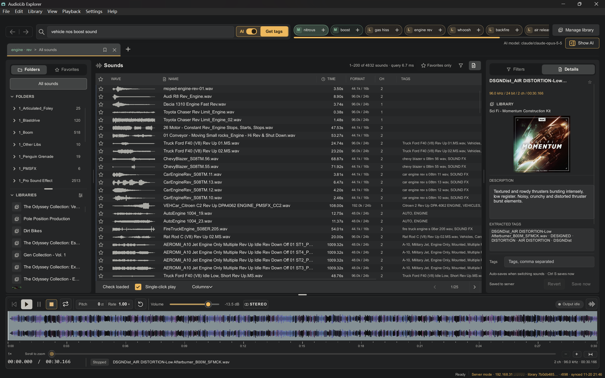

# AudioLib Explorer

> [中文](README.md) · **English**
>
> The repository home shows the Chinese introduction. This page is the same introduction in English. GitHub does not choose between these pages from a visitor's language.


**AudioLib Explorer helps sound designers build a sound-effects library of their own.**

It is free, open-source software for sound design, game audio and Foley: browse, search, preview and maintain Metadata for a personal sound-effects library. It is an open-source alternative to Soundminer. The desktop app is written in Rust with a [Slint](https://slint.dev) interface. Libraries are indexed in SQLite with FTS5.

Use it on one computer, or connect the desktop app to `audiolib-server` on a LAN or behind a public domain. In server mode the client searches a local snapshot. Internet audio can be cached and read on demand. The desktop interface itself can switch between English and Chinese at runtime; that switch is separate from the link above.

From v1.0.0 the desktop app can turn a plain-language sound description into English keyword searches and keep the queries that hit the current library. Limits are in [AI search](#ai-search).

This page describes the source in the branch you are reading. Published packages keep the behavior of their own tag. The latest GitHub Release is [v1.1.1](https://github.com/Freedragonlancer/AudioLib-Explorer/releases/tag/v1.1.1), published 2026-11-20 18:09:43 UTC. Its record is [AudioLib Explorer 1.1.1](doc/Rust_Release_1.1.1.md). The workspace `Cargo.toml` version is shared by the desktop app, `AudioLibCli` and `audiolib-server`.



English interface. AI is on, **Get tags** has produced verified keyword tags, and the current task lists the matching sounds with their waveforms. The selected sound shows its embedded cover beside the list.

## Features

- Up to 30 independent search tasks. The limit is adjustable from 1 to 30 and defaults to 30; a saved personal limit is kept. Each task has its own folder or library index, filters and list state. See [Search tasks](doc/Rust_Search_Tasks.md).
- Four search scopes: **Main fields** (filenames and Metadata), **All** (those fields plus directory names), **Path** (directory names and ancestors) and **Filename**. Path needs a prepared directory index. Without that index, All uses Main fields. FTS5 matches letter fragments of at least two characters, and Chinese text is segmented for indexing. Search text is limited to 500 characters. The search performance **target** is **P95 latency <500ms for 1M+ records**.
- Scan WAV/BWF, MP3, AIFF, FLAC, Ogg Vorbis and Ogg FLAC, including embedded Metadata such as BWF `bext`, iXML, INFO, ID3, XMP and read-only Soundminer `SMED`. Rescans keep user annotations. Source audio is not modified. Opus tags can be probed separately; `.opus` is not scanned by default, and Opus playback is not supported. See [WAV Metadata](doc/Rust_Wav_Metadata.md).
- Playback uses streaming decode, device-rate resampling, Waveform and spectral views, and independent pitch and rate audition. Windows output is WASAPI, with optional ASIO. The macOS arm64 client uses CoreAudio. A remote Waveform can appear progressively and be zoomed after the full peaks are ready. The audition area can be dragged up to 2.5 times its default height. Double-click the pitch or rate control to reset that control.
- Import vendor CSV, TSV, TXT, XLS and XLSX Metadata locally, or on a server when management is allowed. Preview the mapping, confirm ambiguous matches, then commit. An import can be rolled back. Embedded Metadata and user annotations are kept. See [library management](doc/Rust_Library_Management.md#厂商-csv--xls--xlsx-资料导入).
- Library management: add folders, repair moved or renamed files, batch annotations, backup and restore, integrity checks, and JSONL/CSV exchange. Removing records removes database rows and their annotations. It does not delete the source audio.
- `AudioLibCli` for search, scanning, library management and JSON, table or CSV output. It can also control playback in a running desktop app.
- Server mode: `audiolib-server` serves one library over `/api/v1/`. The client opens a validated read-only snapshot. Metadata and management writes go through HTTP bound to that library. See [Local and server mode](#local-and-server-mode).
- English and Chinese desktop interface.
- Desktop AI search, described in [AI search](#ai-search).

<a name="download--install"></a>

## Download and quick start

Installable builds are on [GitHub Releases](https://github.com/Freedragonlancer/AudioLib-Explorer/releases). From 0.8.5, a release contains seven archives and a `.sha256` file for each (fourteen assets). Version 0.8.4 has six archives and twelve assets; 0.8.3 has three archives and six assets; releases through 0.8.2 have two archives and four assets. A tag ending in `-beta.N` or `-rc.N` is a pre-release. Stable and beta installs keep separate data directories.

> [!IMPORTANT]
> Verify each archive against its `.sha256` file before extracting it. The macOS client is ad-hoc signed unless that release's notes name a Developer ID, and it is not Apple-notarized. Do not commit or print server tokens or provider API keys.

| Package | Asset | Updates |
| --- | --- | --- |
| Windows x64 desktop client | `AudioLibExplorer-<tag>-win-x64-portable.zip` | In-app prompt |
| macOS arm64 desktop client | `AudioLibExplorer-<tag>-macos-arm64.zip` | Manual |
| macOS arm64 server | `AudioLibServer-<tag>-macos-arm64.tar.gz` | Server admin page, after the 0.9 layout is installed |
| Windows x64 server, from 0.8.5 | `AudioLibServer-<tag>-win-x64.zip` | Server admin page; the program directory must be writable |
| Linux x64 server | `AudioLibServer-<tag>-linux-x64.tar.gz` | Server admin page, after the 0.9 layout is installed |
| Docker linux/amd64 | `AudioLibServer-<tag>-docker-linux-amd64.tar.gz` | Load a new image and recreate the container |
| Docker linux/arm64 | `AudioLibServer-<tag>-docker-linux-arm64.tar.gz` | Load a new image and recreate the container |

There is no published standalone Linux arm64 server archive. That build is an input to the arm64 Docker image. The desktop updater does not replace the server, and the server updater does not replace the desktop app.

### Windows client

1. Download `AudioLibExplorer-<tag>-win-x64-portable.zip` and its `.sha256` file.
2. Compare the archive with that file:

   ```powershell
   Get-FileHash .\AudioLibExplorer-<tag>-win-x64-portable.zip -Algorithm SHA256
   ```

3. Extract the ZIP and start `Start-AudioLibExplorer.cmd` or `AudioLibExplorer.exe`. No installer is required.
4. Settings, logs, caches and libraries stay in `%LOCALAPPDATA%\AudioLibExplorer\v1`, outside the program folder. `AUDIOLIB_DATA_DIR` selects another directory. Keep that data when you replace the program files.

Day-to-day use of the portable build is covered in [PORTABLE_README.md](PORTABLE_README.md), currently written in Chinese.

<a name="macos-client-apple-silicon"></a>

### macOS client

The Mac client is an Apple Silicon `AudioLib Explorer.app` for macOS 11 or newer. Playback uses CoreAudio. ASIO is not available on macOS.

Verify `AudioLibExplorer-<tag>-macos-arm64.zip.sha256`, extract the ZIP, and move the app into Applications. Quit the app before replacing the bundle. Libraries and settings stay in `~/Library/Application Support/AudioLibExplorer/v1`, or in `AUDIOLIB_DATA_DIR` when that variable is set. Do not put a library inside the app bundle. Updates are manual. The first-open confirmation is macOS's own prompt for software you choose to trust. Details: [MACOS_README.md](MACOS_README.md).

<a name="server-deployment"></a>
<a name="windows-server"></a>
<a name="macos-server"></a>
<a name="linux-server-and-docker"></a>
<a name="upgrade-health-and-a-client"></a>
<a name="managing-sound-libraries-on-the-server"></a>

## Local and server mode

<a name="usage"></a>
<a name="desktop-client-and-cli"></a>

### Local library

A local library is scanned and searched on that computer. Add a folder from the desktop app, or use `AudioLibCli`. Incremental scans read new and changed files. A clean full scan can also mark files that are gone. A per-file scan error is kept on that scan and stops that full scan from marking other files missing.

Packaged commands:

```powershell
AudioLibCli scan "D:\Sounds" --full
AudioLibCli search "explosion" --format table
AudioLibCli stats
```

From a source checkout, the same commands run through `cargo run -p audiolib-cli --`. Creating a library is explicit: `AudioLibCli db create` or `db import`. Ordinary commands do not create a missing library.

User annotations, favorites and playback history for a local library stay in that database. Backup, restore, relinking and import are documented in [library management](doc/Rust_Library_Management.md). Restore and maintenance validate an owned copy and keep a rollback backup.

### Server

`audiolib-server` publishes one existing library. It does not discover a default configuration and it does not create a library. Start it with `--config <path>` or `AUDIOLIB_SERVER_CONFIG`. There is no port flag; the listen address is `bind` in the config file. Create the database first, for example with `AudioLibCli db create`.

> [!WARNING]
> On the public internet, place the server behind a TLS reverse proxy, require a token, and do not publish `/admin`. A token is at least 32 random visible ASCII characters. It is read from the environment, not written into the config file. `auth_mode = "external"` can omit the token for a LAN-direct client. Requests that arrive through a proxy need the token.

The long install, upgrade and root-management steps are in [Server deployment](doc/Server_Deployment.md), [Managing sound libraries on the server](doc/Server_Library_Guide.md), [server/README.md](server/README.md#server-settings) and [server/deploy/README.md](server/deploy/README.md). AI relay, the compatibility snapshot and list-waveform settings are in [Server settings](doc/Server_Deployment.md#server-settings). Windows-specific packaging is in [Windows server release](doc/Rust_Windows_Server_Release.md). Linux packages and the offline Docker images are in [Linux and Docker delivery](doc/Rust_Linux_Docker_Release.md).

**Windows.** Verify `AudioLibServer-<tag>-win-x64.zip`, then extract it to a writable program directory. The ZIP does not register a Windows service. Create the config directory yourself and copy the example only when that config does not already exist:

```powershell
$serverData = Join-Path $env:ProgramData 'AudioLibServer'
New-Item -ItemType Directory -Path $serverData -Force | Out-Null
$serverConfig = Join-Path $serverData 'config.toml'
if (!(Test-Path -LiteralPath $serverConfig)) {
    Copy-Item -LiteralPath .\server\audiolib-server\config.example.toml -Destination $serverConfig
}
.\audiolib-server.exe --config $serverConfig
```

Run the copy from the extracted package. Before the first start, replace the example `library_db` and each `[[roots]].server_path` with the existing database and the real audio directories. TOML single quotes keep Windows backslashes literal, for example `library_db = 'C:\ProgramData\AudioLibServer\library.db'`. Keep the existing config and database when upgrading. The desktop updater does not update this program.

**macOS and Linux.** Verify the archive, then extract it. `audiolib-server` and `audiolib-migrate` are at the archive root. The macOS launchd example is [`server/deploy/launchd/io.github.audiolib.server.plist.example`](server/deploy/launchd/io.github.audiolib.server.plist.example): `AUDIOLIB_LAUNCHD_LABEL` must equal `Label`, and `KeepAlive` must stay enabled, or an admin-page update will not start the process again. The Linux systemd example is [`server/deploy/systemd/audiolib-server.service`](server/deploy/systemd/audiolib-server.service). Its sandbox writes under `/var/lib/audiolib` and reads `/srv/audiolib/music`; another path needs an override. If the library is on a removable or network volume, grant that access to `audiolib-server`, or to a launcher you build from [server/launcher](server/launcher/README.md).

**Docker.** Verify the image archive, `docker load` it, and recreate the container from [`server/deploy/docker/docker-compose.release.yml`](server/deploy/docker/docker-compose.release.yml). The data volume must already contain `/data/library.db`. The image config uses `auth_mode = "all"`, `trust_lan_peers = false` and `manage_mode = "off"`, so set `AUDIOLIB_SERVER_TOKEN` and mount your own config when clients should scan. In-container binary updates are disabled. Replace the image and keep the data volume.

**Preview transcoding.** `GET /audio/{id}/preview?codec=flac` needs a separate ffmpeg and an absolute `ffmpeg_path`. The example default is the macOS Homebrew path. Without ffmpeg, that endpoint returns 503 `TRANSCODER_UNAVAILABLE`. Direct playback of the supported formats uses the bundled decoder and does not need ffmpeg.

**Health.** `GET /api/v1/health` needs no token and returns HTTP 200 while the process is serving. `"status":"ok"` means the library is open. `"starting"` means other routes return 503 `UNAVAILABLE`. `"error"` means open failed and the process keeps retrying. A request to bare `/health` is 404.

```sh
curl -fsS "http://<server-host>:<port>/api/v1/health"
```

**Client.** In the desktop app open **Manage sound library** (Ctrl+D). Add `http://<server-host>:<port>` or `https://audiolib.example.com`, test the connection, then sync. Search uses the snapshot. The client's local working library is a different database and is left unchanged. Embedded covers are requested separately and are not stored in the snapshot. Playback history stays on each client. Windows stores the server token with DPAPI. Secret handling is documented in [Remote mode](doc/Rust_Remote_Mode.md).

**Libraries on the server.** Add a root in `[[roots]]`, on the LAN admin page, or from the client when `manage_mode` allows it. Removing a root deletes indexed records and leaves the audio files in place. Clients see new rows after the snapshot sync.

**Upgrades.** Drain scans and requested Metadata writes before stopping the process. Keep the config, library, SQLite sidecars, tokens and audio directories. Native Windows, macOS arm64 and Linux x64 servers can update from the admin page once `audiolib-migrate` is already beside `audiolib-server`. The first move from a pre-0.9 package is a manual extract. Ordinary local writers stay on schema 8. Schema 9 is an explicit migration:

```sh
audiolib-migrate status --db /path/to/library.db
audiolib-migrate start --db /path/to/library.db
```

The tool keeps `audiolib-rollback-mig9-*.db` beside the library. Replacing the binary does not downgrade schema 9. Client snapshots can read validated schemas 3 through 9. The first successful extended-source write enables `audio_sources:1` and the matching `-af1` format; older clients need to be upgraded before that write. See the [compatibility contract](doc/api/Library_Migration_Compatibility.md) and the [compatibility catalog](crates/audiolib-core/src/compatibility.rs).

<a name="ai-智能搜索"></a>

## AI search

Desktop AI search shipped in [v1.0.0](https://github.com/Freedragonlancer/AudioLib-Explorer/releases/tag/v1.0.0). That release kept at most five verified tags. The current source keeps at most six main-sound queries. When layered material is allowed and those layers have verified hits, main and layer queries together stop at eight, and main queries still stop at six. Color and the M/L markers distinguish main sounds from layers. **Search all** opens the current verified set. Automatic search stays within three tasks.

The search UI is in the desktop app. `AudioLibCli` has no interactive AI search. The server can relay a provider request only when that relay is explicitly enabled. It is off by default and needs an authenticated library server plus an allowlist of upstream protocol and base URL. The provider key is sent with that single request and is not stored on the server. Behavior, editable skills and provider settings are specified in [AI search](doc/Rust_AI_Search.md). [Research and design](doc/AI_Keyword_Search_Design.md) keeps concepts that the app does not ship. SVG wireframes in that note are not application screenshots.

Turn AI on in the desktop search bar and describe the sound in 1–500 characters. **Get tags** (Chinese UI: **生成标签**) asks the offline lexicon, or a configured model, for plain-text keywords, then searches the current folder, scope and filters. The current source verifies at most twelve raw candidates. Each kept query is one or two English words, and a space means AND. A verified single word is placed first when one exists. Clicking the tag text searches the current task. The tag **+** opens one new task with the same folder, scope and filters and does not call the model again.

**Allow layers** starts checked. It lets the model consider independent layers such as impact, bass or debris. The result grows from six to eight only when those layers have verified hits. Clear it to ask only for the main sound. **Search all** opens one task per verified tag, at most six without layers or eight in total with layers, and rejects the whole batch when too few task slots remain. **Auto-search** starts off. When enabled, it opens 1–3 tasks and defaults to 3.

Offline use needs no account, network or API key. The built-in lexicon is version `1.0.0-UCS8.2.1`: 431 keywords, 753 UCS 8.2.1 subcategories and 19 scene recipes. It ranks those stored entries. It is not a general language model. Choose **Local reference (offline)** in **Settings → AI Search…** (Chinese UI: **设置 → AI智能搜索…**).

A cloud model is optional. You supply an HTTPS base URL, an API key and a model id. The model list can be fetched before the profile is saved. Protocols: OpenAI-compatible Chat, OpenAI Responses, OpenAI Official, Anthropic Messages, Gemini, Jev TypeSafe, OpenCode Go, DeepSeek and Magpie. HTTP is allowed for an explicit loopback address. Magpie may also use an explicitly configured private-IP gateway. Windows stores the AI key with the current user's DPAPI. macOS and Linux keep that key for the session. The application does not apply an in-app monthly request limit or sell a subscription. Provider billing stays with the provider.

Optional custom skills are text instructions for a cloud model. The app does not run scripts, open links or load arbitrary paths from those files. Jev selects among a bounded local candidate list and may answer that it is uncertain. Its acceptance thresholds are application policy and have not been calibrated on a sound library.

The request sends the description, the selected prompt and a bounded reference excerpt. Audio, file paths and the open library's Metadata stay out unless you type them into the description or prompt. The model cannot send SQL or write the library.

The current app does not include audio embeddings, in-app subscription purchase or OAuth, provider billing sync, a cross-platform persistent key store, a task for every layer, or a loop that rewrites queries from search results.

## Documentation

The [documentation index](doc/INDEX.md) separates current guides from historical design notes. Many guides under `doc/` are written in Chinese, including [architecture](doc/Rust_Architecture.md), [validation notes](doc/Rust_Validation.md) and the [versioning policy](doc/Rust_Versioning.md). Contributor rules are in [AGENTS.md](AGENTS.md).

| Topic | Document |
| --- | --- |
| Portable Windows use | [PORTABLE_README.md](PORTABLE_README.md) |
| Mac client | [MACOS_README.md](MACOS_README.md) |
| AI search | [doc/Rust_AI_Search.md](doc/Rust_AI_Search.md) |
| Local libraries | [doc/Rust_Library_Management.md](doc/Rust_Library_Management.md) |
| Server mode | [doc/Rust_Remote_Mode.md](doc/Rust_Remote_Mode.md) |
| Server install | [doc/Server_Deployment.md](doc/Server_Deployment.md) |
| HTTP API | [doc/api/README.md](doc/api/README.md) |
| Release history | [doc/Rust_Release_Notes.md](doc/Rust_Release_Notes.md) |

<a name="versioning"></a>
<a name="releases-and-ci"></a>

### Versions and releases

The program version, the HTTP API (`/api/v1/`) and the database schema are independent. Ordinary local writers use schema 8. Release tags are `vX.Y.Z`, `vX.Y.Z-beta.N` or `vX.Y.Z-rc.N`, and the numeric version matches `Cargo.toml`. A suffixed tag is published as a pre-release. The release title is `AudioLib Explorer <tag>`. The policy is [doc/Rust_Versioning.md](doc/Rust_Versioning.md).

The Windows desktop client and the supported native servers check GitHub Releases after a normal start. Confirm the prompt before an update is downloaded and applied. macOS desktop updates are manual. Docker updates replace the image. Channels, checks and the files that stay outside the payload are in [automatic updates](doc/Rust_Auto_Update.md).

GitHub Actions on this repository runs a format check. Functional tests run locally. Publishing a release is a separate, explicit operation and is not part of opening this page.

<a name="build"></a>

## Building from source

Application users can install a Release package and skip this section. The pinned Rust version is 1.97.1. Windows desktop builds use the MSVC toolchain. An ASIO build uses the SDK prepared by `tools/prepare-asio.ps1`; the release scripts do not download an unpinned SDK. Pass `-WithoutAsio` only when that build should omit ASIO.

```powershell
./tools/build-release.ps1
./tools/package-portable.ps1 -SkipBuild
```

The server does not need a playback backend. Because this repository's Cargo config defaults to a Windows target, pass the host target explicitly:

```sh
cargo build --release -p audiolib-server --locked --target "$(rustc -vV | sed -n 's/^host: //p')"
```

Select checks for the code you changed, as described in [AGENTS.md](AGENTS.md#development-checks-by-change-scope). Mac packaging is documented in [MACOS_README.md](MACOS_README.md). Release delivery, when someone explicitly requests it, is documented in [the release pipeline](doc/Rust_Release_Pipeline.md) and [build cache maintenance](doc/Rust_Build_Cache.md). A documentation change is reviewed by reading the diff and running `git diff --check`.

## License

AudioLib Explorer is free software licensed GPL-3.0-only, the GNU General Public License, version 3 only. See [LICENSE](LICENSE). Third-party components are listed in [THIRD_PARTY.md](THIRD_PARTY.md).
