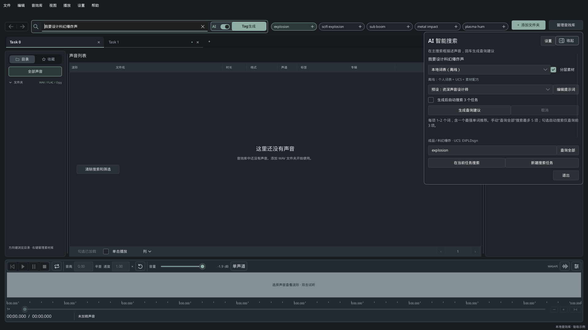

# AudioLib Explorer


[English](README.md)

AudioLib Explorer 是一款本地优先音效库管理软件，使用 Rust 编写，桌面界面基于 [Slint](https://slint.dev)。当前源码将大型 WAV/BWF、MP3、AIFF、FLAC、Ogg Vorbis/OGA 音效库索引到 SQLite（FTS5），支持路径、内嵌标签及厂商 Metadata 搜索，在 Windows 上通过 WASAPI（可选 ASIO）试听，也可以浏览由 `audiolib-server` 提供的远程音效库。macOS arm64 客户端使用 CoreAudio；0.8.4 增加 Linux x64 服务端和 Docker amd64/arm64 离线镜像。

v1.0.0 起，桌面端提供 AI 智能搜索：用自然语言描述声音，得到经当前资料库命中核验的英文关键词，当前 beta 最多 6 个（已发布的 v1.0.0 最多 5 个）。离线词表无需账号；云端模型需自备 HTTPS 供应商、API Key 和模型。服务端和 `AudioLibCli` 不提供该功能。详见 [AI 智能搜索](#ai-智能搜索)。

- **当前正式版：** [v1.0.0](https://github.com/Freedragonlancer/AudioLib-Explorer/releases/tag/v1.0.0)，于 2026-11-13 发布；七份正式包、十四项线上资产与 SHA256、实际平台验收及发布后固定安装同步见 [1.0.0 发布记录](doc/Rust_Release_1.0.0.md)。发布产物来自最终 main/tag `1fc6f825`；当前 beta 的源码更新不替换这些已发布文件。
- **HTTP API：** `/api/v1/`（客户端与服务端）
- **数据库 schema：** 普通本地 writer 为8；服务端显式迁移后为9，使用专用 writer；客户端只读校验快照3..=9。
- **可写库格式：** 本地 base 为 `ale-s8-cld1-t3-m2-p1-a1`，专用服务端 schema-9 base 为 `ale-s9-cld1-t3-m2-p1-a1-sd1`；首次新源成功写入的同一事务启用必需 `audio_sources:1` 及对应 `-af1` 完整格式，旧客户端须升级，详见[兼容说明](doc/api/Library_Migration_Compatibility.md)。受支持的 schema 3–7 仅作为只读迁移来源。schema 8 使用共享专辑实体，Metadata 保留为原始 JSON TEXT。Metadata 压缩暂缓，快照传输仍使用 zstd。
- **许可证：** [GPL-3.0-only](LICENSE)

程序版本取自工作区 `Cargo.toml`，由客户端、CLI 和服务端共用。当前格式以[兼容目录](crates/audiolib-core/src/compatibility.rs)为准；[历史 schema v6 契约](doc/api/Schema_V6_Iteration.md)描述此前的格式。

## 下载与安装

从 0.8.5 起，每次 Release 发布七个归档及各自的 `.sha256`，共十四个资产（新增 Windows x64 服务端）；0.8.4 保留六个归档、十二个资产；0.8.3 保留三个包、六个资产，0.8.2 及更早版本保留两个包、四个资产。

| 程序包 | Release 文件名 | 更新方式 |
| --- | --- | --- |
| Windows x64 客户端 | `AudioLibExplorer-<tag>-win-x64-portable.zip` | 程序内自动更新 |
| macOS arm64 客户端 | `AudioLibExplorer-<tag>-macos-arm64.zip` | 初期手动安装与更新 |
| macOS arm64 服务端 | `AudioLibServer-<tag>-macos-arm64.tar.gz` | 0.9新布局首次手动引导，之后管理页面更新 |
| Windows x64 服务端（0.8.5 起） | `AudioLibServer-<tag>-win-x64.zip` | 0.9新布局首次手动引导，之后服务端管理页更新；须显式指定配置 |
| Linux x64 服务端 | `AudioLibServer-<tag>-linux-x64.tar.gz` | 0.9新布局首次手动引导，之后管理页面更新 |
| Docker amd64 | `AudioLibServer-<tag>-docker-linux-amd64.tar.gz` | 导入镜像并重建容器 |
| Docker arm64 | `AudioLibServer-<tag>-docker-linux-arm64.tar.gz` | 导入镜像并重建容器 |

Windows 客户端解压后通过 `Start-AudioLibExplorer.cmd` 启动。Mac 客户端面向 Apple Silicon，校验 ZIP 的 SHA256 后解压得到 `AudioLib Explorer.app`，手动安装；替换旧 app 前先正常退出，并保留原数据目录和资料库。详见 [Mac 客户端指南](https://github.com/Freedragonlancer/AudioLib-Explorer/blob/main/MACOS_README.md)。

首次 Mac 分发计划使用 ad-hoc 签名，未经 Apple 公证。原生签名、隔离启动和包边界检查须在 Mac 上通过后才可发布，Windows 验证结果不能替代这些检查。Windows 服务端包自 0.8.5 起提供，见 [Windows 服务端发布](doc/Rust_Windows_Server_Release.md)。独立 Linux arm64 服务端包不发布。Docker 离线包校验后使用 `docker load` 导入；详见 [Linux 与 Docker 交付](https://github.com/Freedragonlancer/AudioLib-Explorer/blob/main/doc/Rust_Linux_Docker_Release.md)。

## AI 智能搜索



桌面端 AI 智能搜索界面，使用示例描述和关键词。声音列表为空，没有连接服务器。

桌面端 AI 智能搜索随 [v1.0.0](https://github.com/Freedragonlancer/AudioLib-Explorer/releases/tag/v1.0.0) 发布，该正式版最多保留 5 个已核验标签。当前 beta 将标签与“查询全部”上限增至 6 个，自动搜索仍最多 3 项。服务端和 `AudioLibCli` 不提供该功能。行为与限制见 [实现说明](doc/Rust_AI_Search.md)。[研究与设计](doc/AI_Keyword_Search_Design.md) 保留了 1.0 未交付的概念；其中的 SVG 线框不是应用截图。英文对照见 [README.md](README.md#ai-search)。

在桌面搜索条打开 AI，用 1–500 个字符描述声音，再点 **Tag生成**。离线词表或已配置的模型给出纯文本关键词，再按当前目录、搜索范围和筛选做实际检索；当前 beta 从最多 12 条原始候选中保留有命中的查询，最多 6 条。每条是 1 或 2 个英文词，空格表示 AND。能核验出单词时把它放在第一位。点击标签正文在当前任务搜索；标签上的 **+** 用相同目录、范围和筛选新建一个任务，不再请求模型。**分层素材** 默认勾选，可同时给出素材层查询；取消后只请求成品声音。**查询全部** 为每个已核验标签各建一个任务，最多 6 个，任务名额不足时整批拒绝。**生成后自动搜索 3 个任务** 默认关闭，开启后仍最多搜索前 3 项。

离线词表版本 `1.0.0-UCS8.2.1`，含 431 条关键词、753 条 UCS 8.2.1 子类和 19 个场景配方，按条目排序，不是通用语言模型，也不需要账号、网络或 API Key。在 **设置 → AI智能搜索…** 选择 **本地词表（离线）**。

云端模型可选。需要自行填写 HTTPS 地址、API Key 和模型 ID；保存配置前可以获取模型列表。协议包括 OpenAI 兼容 Chat、OpenAI Responses、Anthropic Messages、Gemini、Jev TypeSafe、OpenCode Go 和 DeepSeek。除显式 loopback 外不使用 HTTP。Windows 用当前用户 DPAPI 保存密钥；macOS 与 Linux 只在本次会话保留。本机按 UTC 月份累计生成尝试，失败和超时也计入；这不是供应商余额，获取模型列表不计入。Jev 只在有限的本地候选中选择，也可以返回不确定。接受阈值是应用策略，尚未用音效库校准。1.0 的发布验收没有调用付费供应商账户。

请求只包含描述、所选提示词和有限参考摘录。除非写进描述或提示词，否则不发送音频、文件路径或当前音库 Metadata。模型不能提交 SQL，也不能写入资料库。

1.0 尚未包含：音频 embedding、理解没有 Metadata 的文件、OAuth 与应用内购买订阅、同步供应商账单、macOS/Linux 持久密钥、为每一素材层自动建任务，以及根据检索结果自动改写查询。

## 功能

- 最多30个独立搜索任务页签，保存各自目录、范围、筛选和列表状态，支持个人收藏与重启恢复。详见[搜索任务](doc/Rust_Search_Tasks.md)。
- 桌面端 AI 智能搜索（v1.0.0）：离线关键词、UCS 与配方，或可选的自备模型，再走现有 FTS5。见 [AI 智能搜索](#ai-智能搜索)。
- 增量/完整扫描 WAV、FLAC、OGG、OGA，提取专业 WAV Metadata（BWF `bext`、iXML、INFO、ID3、XMP、只读 Soundminer SMED）及 Vorbis comment，保留重复值、中文和未知字段。内嵌原文与用户标注分开保存。OpusTags 可提取，原生播放器不解码 Opus；链式 Ogg 至少提取首个逻辑流。
- 四种搜索范围：主字段保留旧字段搜索，仅文件名严格限定名称，仅路径匹配目录/祖先，全部支持跨来源组合；支持中文分词、目录/专辑/收藏/Metadata筛选和排序。路径范围需先完成索引准备；本地准备保持 schema8。目标为 **P95 latency <500ms for 1M+ records**。
- 本地和有管理权限的服务器模式支持厂商 CSV、XLS、XLSX：编码/表头/sheet预览、列映射与模板、路径/文件名匹配、歧义候选分页确认、幂等批次提交、取消/续导与回滚。厂商和内嵌文本都参与搜索，用户标注保留。
- 流式解码播放、设备采样率重采样、Waveform 与频谱视图、独立的音高/速率试听（SoundTouch），支持 WASAPI 与可选 ASIO 输出。
- 资料库管理：添加文件夹、修复被移动或改名的文件、批量标注、备份/恢复、完整性检查、JSONL/CSV 交换。
- 命令行工具 `AudioLibCli`（JSON/表格/CSV 输出、库管理、控制正在运行的桌面实例播放）。
- 服务器模式：`server/audiolib-server` 通过 `/api/v1/` 提供一个资料库（快照、Range 流式音频、预览、Waveform、令牌认证、仅局域网管理页）。客户端只读打开经过校验的快照；Metadata 和管理写入使用绑定库身份的 HTTP 请求。已测旧服务端 0.4.11 和 0.5.0 仍可读取。
- 中英文双语界面。

服务端迁移前先准备可读8/9的客户端、隔离副本和回滚备份。0.9服务端包加入离线 `audiolib-migrate`，超出旧更新器白名单，因此首次手动引导安装；保留旧程序、launcher、配置及数据，确认仍为8后再显式启动迁移。完成9后，新客户端取得9；默认过渡期为旧端提供 WAV-only 的真实8快照，旧端不得写9。配置关闭兼容快照后，旧客户端保留最后有效缓存。部署顺序、保留周期和回退边界见[发布与迁移方案](doc/Rust_Release_0.9.0.md)。播放历史仅保存在各客户端本机。

## 构建

Windows 客户端要求 MSVC 构建工具以及固定版本的 Rust 工具链（见 `rust-toolchain.toml`）。ASIO 构建还需要 LLVM（libclang），并使用固定且校验哈希的 Steinberg ASIO SDK（由 `tools/prepare-asio.ps1` 下载）。

```powershell
# 使用已校验的 ASIO SDK 构建一次，再打包（dist/latest/portable）。
./tools/build-release.ps1
./tools/package-portable.ps1 -SkipBuild
```

发布脚本只构建 desktop/CLI binaries。交付无 ASIO 版本时，上述两条命令及 portable 验收均传入 `-WithoutAsio`。带标签的 Windows 包也可改用兼容手动入口 `tools/ci-release.ps1 -Tag <tag>`，替代上述两条命令；其报告中运行时为 `not-run`。随后完整 portable 验收一次，再按[固定本地安装流程](AGENTS.md#mandatory-local-application-delivery-and-release-installation)交付。服务端使用 `tools/build-server-release.ps1` 及对应平台打包器。

带标签的本地交付可用 `pwsh tools/release-pipeline.ps1 -Action Run -Tag <tag>`，一次串联预检、构建、打包、portable 验收和固定安装。默认只预览计划；执行时输出短 JSON，完整日志落盘，续跑复用仍有效的阶段。源码检查仍按改动选择。服务端、Mac 和只读发布资产检查计划见[管线指南](https://github.com/Freedragonlancer/AudioLib-Explorer/blob/main/doc/Rust_Release_Pipeline.md)。

完成实际编译/测试后，可给本地检查或发布管线加 `-CleanBuildArtifacts`，超过默认 40 GiB 预算才清理 debug 缓存，预算由 `-BuildCacheLimitGiB` 调整。独立预览用 `pwsh tools/clean-build-artifacts.ps1`；release 产物、包、固定安装、SDK 和用户数据保留。详见[编译缓存维护](https://github.com/Freedragonlancer/AudioLib-Explorer/blob/main/doc/Rust_Build_Cache.md)。

Mac 客户端在 Apple Silicon Mac 上构建，需要 Xcode 命令行工具、固定的原生 Rust 工具链和 PowerShell 7.3 以上版本。在已验收的 main/tag 提交上运行 `tools/build-macos-client.ps1 -ExpectedCommit <完整提交> -ReportPath <私有构建证明.json>`，再使用该证明运行 `tools/package-macos-client.ps1 -Tag v0.9.5 -ExpectedCommit <完整提交> -BuildReport <私有构建证明.json>`。在已登录桌面的 Mac 上给打包命令加 `-ValidateRuntime`，一次完成结构与原生运行验收；仅延后运行验收、产物变化或换机复核时单独运行 `validate-macos-client.ps1`。仅结构检查的运行时结果为 `not-run`。完整参数见 [Mac 客户端指南](https://github.com/Freedragonlancer/AudioLib-Explorer/blob/main/MACOS_README.md)。

服务端可在 Windows、Linux、macOS 上构建（不需要音频播放支持）。由于仓库的 `.cargo/config.toml` 默认目标是 Windows，需显式指定目标：

```sh
cargo build --release -p audiolib-server --locked --target "$(rustc -vV | sed -n 's/^host: //p')"
```

开发检查（以下以数据库片段搜索改动为例，按实际改动选择 package 和测试目标）：

```powershell
cargo fmt --all -- --check
cargo clippy -p audiolib-db --all-targets --locked -- -D warnings
cargo test -p audiolib-db --test search_fragments --locked
```

纯文档只需检查差异、链接和 `git diff --check`；UI 文案和布局改动检查编译及受影响界面。稳定且未受影响的模块沿用已有通过基线，不重复回归。用 `./tools/check-local.ps1 -Package <packages>` 显式选择受影响包；单包可加 `-Lib`、`-Bin <name>` 或 `-Test <integration-target>`，并以 `-TestFilter <substring>` 进一步选择测试。仅影响广泛或不明确时使用 `-Workspace`；遗漏范围参数会在执行前报错。`-Asio` 选择 Windows 发布特性，同一套检查只跑一遍；无 ASIO 条件分支仅在受改动影响时定向补测。相关源码、依赖、feature、工具链和环境未变时复用通过结果；专项回归和性能测量按实际行为变化触发。详见[验证范围](AGENTS.md#development-checks-by-change-scope)、[稳定模块的回归精简](doc/Testing_Strategy.md#稳定模块的回归精简)和[阶段职责](doc/Testing_Strategy.md#本地验证与云端最小检查)。

日常代码工作通过定向开发检查即可完成；发布构建、打包、完整 portable 验收和安装这一整套交付流程仅在明确要求本地试用、交付或发布时执行。风险专项需要当前 EXE 或包时仍构建所需产物，但不自动触发安装或部署。UI 改动可用隔离数据的开发构建检查。已有仍有效的格式/Clippy 结果时，用 `check-local.ps1 -Stage Tests` 补测选定用例；`-Stage Clippy` 只运行严格静态检查。默认仍为 `-Stage All`，未执行阶段明确记为 `not-requested`。详见[日常开发的完成条件](doc/Testing_Strategy.md#日常开发的完成条件)。

明确要求本地快速试用时，用现有 Release 管线选择 `tools/release-plans/windows-local.json`：省略 ZIP 压缩，保留完整 portable 验收并安装到 `local_release/`，失败后续跑有效阶段。命令和源码身份要求见[本地快速验收](doc/Rust_Release_Pipeline.md#本地快速验收)。

## 使用

### 桌面客户端与 CLI

```powershell
cargo run -p audiolib-desktop
cargo run -p audiolib-cli -- scan "D:/Sounds" --full
cargo run -p audiolib-cli -- search "explosion" --format table
cargo run -p audiolib-cli -- stats
```

用户设置、日志、缓存和资料库位于 `%LOCALAPPDATA%/AudioLibExplorer/v1`；设置 `AUDIOLIB_DATA_DIR` 可使用隔离的数据目录。在“数据源”窗口选择服务器模式，填写服务器地址（例如 `https://audiolib.example.com:8443` 或 `http://server.example.lan:8790`），服务器要求时再填访问令牌。详见 [远程模式](doc/Rust_Remote_Mode.md) 与 [资料库管理](doc/Rust_Library_Management.md)。

### 服务端

服务端必须通过 `--config <路径>` 或 `AUDIOLIB_SERVER_CONFIG` 指定配置；不会自动发现默认配置或创建资料库。

Windows：校验 `AudioLibServer-<tag>-win-x64.zip` 的 SHA256 后解压到可写的程序目录。已选定的推荐配置/数据目录为 `%ProgramData%\AudioLibServer`，与程序目录分离，须显式创建。在解压目录中首次复制配置示例：

```powershell
$serverData = Join-Path $env:ProgramData 'AudioLibServer'
New-Item -ItemType Directory -Path $serverData -Force | Out-Null
$serverConfig = Join-Path $serverData 'config.toml'
if (!(Test-Path -LiteralPath $serverConfig)) {
    Copy-Item -LiteralPath .\server\audiolib-server\config.example.toml -Destination $serverConfig
}
```

启动前编辑该配置：把 Unix 示例中的 `library_db` 和每个 `[[roots]].server_path` 换为已有的 Windows 资料库和真实音频目录。Windows 路径可使用 TOML 单引号字符串，例如 `library_db = 'C:\ProgramData\AudioLibServer\library.db'` 和 `server_path = 'D:\Sounds'`；升级时保留配置路径与资料库。新客户端内置 FLAC、Vorbis 和 Ogg-FLAC 直接解码。仅在需要服务端预览转码时另行安装 ffmpeg，并设置绝对路径，例如 `ffmpeg_path = 'C:\Tools\ffmpeg\bin\ffmpeg.exe'`；缺少 ffmpeg 时该预览端点返回503 `TRANSCODER_UNAVAILABLE`，直接流及客户端原生解码继续可用。

保存配置后显式启动：

```powershell
.\audiolib-server.exe --config $serverConfig
```

Windows 服务端0.9新布局首次采用手动引导安装，后续由自身管理页更新，程序目录须可写。ZIP 提供 server 与离线迁移工具；Windows 服务注册及数据目录按[Windows 服务端发布](doc/Rust_Windows_Server_Release.md)配置。

Linux 示例：

```sh
cp server/audiolib-server/config.example.toml /etc/audiolib/config.toml   # 编辑根目录和数据库路径
audiolib-server --config /etc/audiolib/config.toml
```

**部署与使用指南：** [服务端部署](doc/Server_Deployment.md)、[服务端音效库管理](doc/Server_Library_Guide.md)。平台单元与管理页仍见 [server/README.zh-CN.md](server/README.zh-CN.md) 与 [server/deploy/README.md](server/deploy/README.md)，API 契约见 [doc/api/README.md](doc/api/README.md)。面向公网时请放在带 TLS 的反向代理之后并启用令牌。

### Linux 服务、Docker、升级与健康检查

Linux x64 归档为 `AudioLibServer-<tag>-linux-x64.tar.gz`，根目录有 `audiolib-server` 与 `audiolib-migrate`。示例 systemd 单元是 [`server/deploy/systemd/audiolib-server.service`](server/deploy/systemd/audiolib-server.service)：以 `audiolib` 用户运行，从 `/etc/audiolib/audiolib.env` 读取令牌，配置为 `/etc/audiolib/config.toml`。单元允许写 `/var/lib/audiolib`，并以只读方式访问 `/srv/audiolib/music`；其他路径需要 override。独立 Linux arm64 包不发布。

Docker Release 使用 `AudioLibServer-<tag>-docker-linux-amd64.tar.gz` 与 `AudioLibServer-<tag>-docker-linux-arm64.tar.gz`。校验 SHA256 后 `docker load`，按 [`server/deploy/docker/docker-compose.release.yml`](server/deploy/docker/docker-compose.release.yml) 重建容器。数据卷里须已有 `/data/library.db`。镜像配置为 `auth_mode = "all"`、`trust_lan_peers = false`、`manage_mode = "off"`，因此要设置 `AUDIOLIB_SERVER_TOKEN`；若希望客户端扫描，请挂载自己的配置。容器内关闭二进制更新，升级时替换镜像并保留数据卷。镜像健康检查请求 `/api/v1/health`，并要求 `"status":"ok"`。

升级前先排空扫描。保留配置、资料库、令牌和音频目录。Windows、macOS arm64 与 Linux x64 在已经装好 0.9 布局（`audiolib-server` 与 `audiolib-migrate` 并列）之后，可由管理页更新，程序目录须可写。从 0.9 之前的包第一次换上该布局须手动解压，旧更新器会拒绝新增的迁移程序。0.9.5 沿用 0.9.4 的 schema 8/9 写目标，首次扩展源写入会启用 AF1，扫描前须先升级客户端。schema 9 须显式执行 `audiolib-migrate status --db /path/to/library.db`，再 `audiolib-migrate start --db /path/to/library.db`（`pause`、`resume`、`cancel`、`rollback` 使用同一 `--db`）。工具会在库旁保留 `audiolib-rollback-mig9-*.db`。只替换二进制不能把 schema 9 退回 schema 8。

`GET /api/v1/health` 无需令牌，进程在服务时返回 HTTP 200。`"status":"ok"` 表示库已打开；`"starting"` 时其他接口返回 503 `UNAVAILABLE`；`"error"` 表示打开失败且进程会继续重试。裸路径 `/health` 为 404。

```sh
curl -fsS "http://<server-host>:<port>/api/v1/health"
```

客户端打开「音效库管理」（Ctrl+D），添加服务器地址 `http://<server-host>:<port>` 或 `https://audiolib.example.com`，测试连接后同步。`auth_mode` 为 `external` 时，局域网直连可以不填令牌。搜索在本机快照上执行。步骤详见 [服务端部署](doc/Server_Deployment.md)。

## 服务端音效库管理

服务端只索引一个资料库。根目录可写在配置的 `[[roots]]` 中，也可在局域网管理页添加，或在客户端「音效库管理」里用「＋ 添加音效库」（须当前数据源已打开快照，且 `manage_mode` 允许本机管理）。删除根目录只删除库中的记录和标注，磁盘上的音频文件保留。日常用增量扫描处理新增和修改；干净的完整扫描还会把找不到的文件标为缺失。同一次扫描会导入 sidecar CSV/TSV/XLS/XLSX：表格若直接放在 `{stem}--Docs` 或 `{stem}--Sounds*` 目录，还可以匹配同 stem 兄弟目录子树里的 WAV。客户端在快照同步之后看到新记录。内嵌封面单独请求，不写进快照。单文件错误（例如 `Audio: Truncated WAV chunk …`、`Audio: Unsupported Ogg audio identification packet`）记在该次扫描上，并使这次完整扫描不再把其他文件标为缺失。

兄弟目录规则、封面、客户端能看到的内容，以及常见扫描错误见 [服务端音效库管理](doc/Server_Library_Guide.md)。

## 版本规范

程序 SemVer（工作区 `Cargo.toml`，客户端、CLI、服务端共用）、HTTP API 版本（`/api/v1/`）、数据库 schema（`SCHEMA_VERSION`，当前为 8）互相独立。允许的操作还须由兼容目录及完整 feature/format 描述判定，不能仅凭 schema 数字认定兼容。仅精确匹配当前目标的格式可写；受支持的 schema 3–7 格式须经校验并迁移为当前目标后才能写入。迁移保护约束见[历史迁移兼容设计](doc/api/Library_Migration_Compatibility.md)，当前格式见[兼容目录](crates/audiolib-core/src/compatibility.rs)。schema 变化时程序版本至少升 MINOR。发布标签为 `vX.Y.Z`、`vX.Y.Z-beta.N` 或 `vX.Y.Z-rc.N`，必须与 `Cargo.toml` 版本一致（忽略标签后缀），由 `tools/check-release.ps1` 检查。详见 [doc/Rust_Versioning.md](doc/Rust_Versioning.md)。

## 发布与 CI

Windows 客户端与受支持的服务端在每次正常启动后于后台检查 GitHub Release。发现新版后，在客户端提示或服务端管理页面确认，即可下载、校验，并在现有工作排空后部署。初期 Mac 客户端采用手动更新。正式版和 beta 保留各自的更新渠道，资料库和偏好设置不属于更新包。渠道、打包元数据及部署方式详见[自动更新](doc/Rust_Auto_Update.md)。

源码开发版本以工作区 `Cargo.toml` 为准。发布状态和实际安装版本需分别核对。

GitHub Actions 在相关 `main`、`beta`、`codex/**` 推送及所有 Pull Request 时只运行一个 Linux 格式检查作业。纯文档和截图推送跳过；每个 PR 均返回 required `Linux (fmt)` 检查。Rust 测试、Clippy、UI/服务端启动、回归和性能测量按范围在本地执行。每份正式 payload 从最终 main/tag 身份构建、打包一次并本地验收，再上传发布。`.github/workflows/release.yml` 仅可选手动触发，只读核验 Release 身份、[版本对应的精确资产集合](doc/Rust_Versioning.md#规则)和 SHA256，不重复运行验收；推送标签不会启动它。实际包的白名单、隐私及二进制身份由本地打包/验收负责。构建与运行验收报告保持私有，不作为额外 Release 资产上传。

## 文档

`doc/` 下的大部分文档目前为中文（如[版本规范](doc/Rust_Versioning.md)、[架构](doc/Rust_Architecture.md)、[验证记录](doc/Rust_Validation.md)），英文版将在后续补充。[文档索引](doc/INDEX.md)区分当前指南与历史设计文档。贡献者约定见 [AGENTS.md](AGENTS.md)。

## 许可证

AudioLib Explorer 是自由软件，采用 GNU 通用公共许可证第 3 版（仅 GPL-3.0）。见 [LICENSE](LICENSE)。第三方组件及其许可证见 [THIRD_PARTY.md](THIRD_PARTY.md)。
