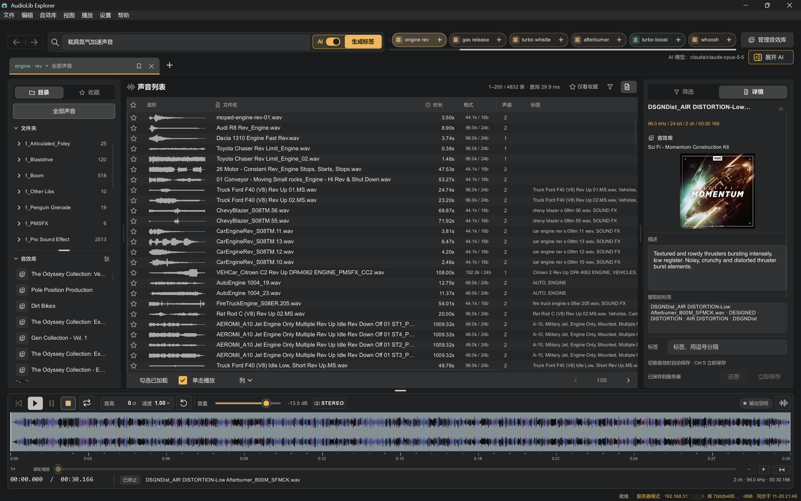

# AudioLib Explorer

> [English](README.md) · **中文**
>
> 仓库首页显示英文说明。本页是同一份中文介绍。GitHub 不会按访客的语言在这两页之间自动选择。


**AudioLib Explorer 帮助声音设计师建立自己的音效库。**

这是面向声音设计、游戏音频和影视拟音（Foley）的开源免费软件，用来浏览、检索、试听和维护个人音效库的 Metadata，也可作为 Soundminer 的开源替代。桌面端使用 Rust 和 [Slint](https://slint.dev)。资料库索引使用 SQLite 与 FTS5。

可以在一台电脑上使用，也可以把桌面端连接到局域网或公网域名上的 `audiolib-server`。服务器模式下，客户端在本地快照上搜索。公网音频可以缓存并按需读取。桌面界面本身可以在运行时切换中文和英文；那个开关与上方的链接是两件事。

自 v1.0.0 起，桌面端可以把一段自然语言声音描述转成英文关键词搜索，并保留当前资料库里实际命中的查询。限制见 [AI 智能搜索](#ai-智能搜索)。

本页描述你正在阅读的分支里的源码。已发布的安装包保留各自标签的行为。最新的 GitHub Release 是 [v1.1.0](https://github.com/Freedragonlancer/AudioLib-Explorer/releases/tag/v1.1.0)，发布于 2026-11-20 12:25:23 UTC。发布记录见 [AudioLib Explorer 1.1.0](doc/Rust_Release_1.1.0.md)。工作区 `Cargo.toml` 中的版本由桌面端、`AudioLibCli` 和 `audiolib-server` 共用。



中文界面。AI 已打开，**生成标签**给出已核验的关键词标签，当前任务列出命中的声音和 Waveform。选中的声音在列表旁显示内嵌封面。

## 功能

- 最多 30 个独立搜索任务。上限可在 1 到 30 之间调整，默认 30；已保存的个人上限会保留。每个任务有自己的文件夹或资料库索引、筛选和列表状态。见[搜索任务](doc/Rust_Search_Tasks.md)。
- 四种搜索范围：**主字段**（文件名和 Metadata）、**全部**（上述字段再加目录名）、**仅路径**（目录名和祖先目录）和**仅文件名**。仅路径需要准备好的目录索引。没有该索引时，全部范围改用主字段。FTS5 匹配至少两个字母的片段，中文文本会分词后索引。搜索文本最长 500 个字符。搜索性能**目标**是 **P95 latency <500ms for 1M+ records**。
- 扫描 WAV/BWF、MP3、AIFF、FLAC、Ogg Vorbis 和 Ogg FLAC，并提取内嵌 Metadata，包括 BWF `bext`、iXML、INFO、ID3、XMP 和只读 Soundminer `SMED`。重新扫描会保留用户标注。源音频不会被修改。Opus 标签可以单独探测；默认不扫描 `.opus`，也不支持播放 Opus。见 [WAV Metadata](doc/Rust_Wav_Metadata.md)。
- 播放使用流式解码、按设备采样率重采样、Waveform 与频谱视图，以及彼此独立的音高和速度试听。Windows 输出为 WASAPI，可选 ASIO。macOS arm64 客户端使用 CoreAudio。远端 Waveform 可以逐步显示，完整峰值就绪后再缩放。试听区最多可拖到默认高度的 2.5 倍。双击音高或速度控件可单独复位。
- 在本地导入厂商 CSV、TSV、TXT、XLS 和 XLSX Metadata；服务器在允许管理时也可以导入。先预览映射并确认歧义匹配，再提交。导入可以回滚。内嵌 Metadata 和用户标注会保留。见[资料库管理](doc/Rust_Library_Management.md#厂商-csv--xls--xlsx-资料导入)。
- 资料库管理：添加文件夹、修复被移动或改名的文件、批量标注、备份与恢复、完整性检查，以及 JSONL/CSV 交换。移除记录只删除数据库中的行和对应标注，不删除源音频。
- `AudioLibCli` 用于搜索、扫描、资料库管理，以及 JSON、表格或 CSV 输出。它也可以控制正在运行的桌面端播放。
- 服务器模式：`audiolib-server` 通过 `/api/v1/` 提供一个资料库。客户端打开经过校验的只读快照。Metadata 和管理写入使用绑定该资料库身份的 HTTP 请求。见[本地与服务器模式](#本地与服务器模式)。
- 桌面界面支持中文和英文。
- 桌面端 AI 智能搜索，见 [AI 智能搜索](#ai-智能搜索)。

<a name="下载与安装"></a>

## 下载与快速开始

可安装的构建在 [GitHub Releases](https://github.com/Freedragonlancer/AudioLib-Explorer/releases)。从 0.8.5 起，一次 Release 包含七个归档及各自的 `.sha256` 文件，共十四个资产。0.8.4 是六个归档、十二个资产；0.8.3 是三个归档、六个资产；0.8.2 及更早版本是两个归档、四个资产。以 `-beta.N` 或 `-rc.N` 结尾的标签是预发布版。正式版和 beta 使用各自的数据目录。

> [!IMPORTANT]
> 解压前用对应的 `.sha256` 文件核对每个归档。macOS 客户端采用 ad-hoc 签名，除非该版本的发布说明写明了 Developer ID；它没有经过 Apple 公证。不要把服务器令牌或供应商 API Key 提交到仓库，也不要把它打印出来。

| 程序包 | 文件 | 更新方式 |
| --- | --- | --- |
| Windows x64 桌面客户端 | `AudioLibExplorer-<tag>-win-x64-portable.zip` | 程序内提示 |
| macOS arm64 桌面客户端 | `AudioLibExplorer-<tag>-macos-arm64.zip` | 手动 |
| macOS arm64 服务端 | `AudioLibServer-<tag>-macos-arm64.tar.gz` | 已装好 0.9 布局后，用服务端管理页 |
| Windows x64 服务端（0.8.5 起） | `AudioLibServer-<tag>-win-x64.zip` | 服务端管理页；程序目录必须可写 |
| Linux x64 服务端 | `AudioLibServer-<tag>-linux-x64.tar.gz` | 已装好 0.9 布局后，用服务端管理页 |
| Docker linux/amd64 | `AudioLibServer-<tag>-docker-linux-amd64.tar.gz` | 导入新镜像并重建容器 |
| Docker linux/arm64 | `AudioLibServer-<tag>-docker-linux-arm64.tar.gz` | 导入新镜像并重建容器 |

没有单独发布的 Linux arm64 服务端归档。该构建是 arm64 Docker 镜像的输入。桌面端更新器不替换服务端，服务端更新器也不替换桌面端。

### Windows 客户端

1. 下载 `AudioLibExplorer-<tag>-win-x64-portable.zip` 及其 `.sha256` 文件。
2. 用该文件核对归档：

   ```powershell
   Get-FileHash .\AudioLibExplorer-<tag>-win-x64-portable.zip -Algorithm SHA256
   ```

3. 解压 ZIP，启动 `Start-AudioLibExplorer.cmd` 或 `AudioLibExplorer.exe`。不需要安装程序。
4. 设置、日志、缓存和资料库位于程序目录之外的 `%LOCALAPPDATA%\AudioLibExplorer\v1`。`AUDIOLIB_DATA_DIR` 用来选择另一个目录。替换程序文件时保留这些数据。

便携版的日常使用见 [PORTABLE_README.md](PORTABLE_README.md)，目前为中文。

### macOS 客户端

Mac 客户端是适用于 macOS 11 或更新版本的 Apple Silicon 应用 `AudioLib Explorer.app`。播放使用 CoreAudio。macOS 上没有 ASIO。

核对 `AudioLibExplorer-<tag>-macos-arm64.zip.sha256`，解压 ZIP，再把 app 移到“应用程序”。替换应用包之前先退出。资料库和设置位于 `~/Library/Application Support/AudioLibExplorer/v1`；设置了 `AUDIOLIB_DATA_DIR` 时使用该目录。不要把资料库放进 app 包内。更新是手动的。首次打开时的确认是 macOS 对你选择信任的软件给出的提示。详见 [MACOS_README.md](MACOS_README.md)。

<a name="使用"></a>
<a name="桌面客户端与-cli"></a>

## 本地与服务器模式

### 本地资料库

本地资料库在这台电脑上扫描和搜索。从桌面端添加文件夹，或使用 `AudioLibCli`。增量扫描读取新增和已更改的文件。一次干净完成的全量扫描还可以把已经不在的文件标为缺失。扫描中的单个文件错误会留在该次扫描上，并使这次全量扫描不再把其他文件标为缺失。

安装包中的命令：

```powershell
AudioLibCli scan "D:\Sounds" --full
AudioLibCli search "explosion" --format table
AudioLibCli stats
```

在源码目录中，同样的命令通过 `cargo run -p audiolib-cli --` 运行。创建资料库必须显式执行：`AudioLibCli db create` 或 `db import`。普通命令不会创建缺失的资料库。

本地资料库的用户标注、收藏和播放历史保存在该数据库中。备份、恢复、重新链接和导入见[资料库管理](doc/Rust_Library_Management.md)。恢复和维护会校验自有副本并保留回滚备份。

<a name="服务端"></a>
<a name="linux-服务docker升级与健康检查"></a>
<a name="服务端音效库管理"></a>

### 服务器

`audiolib-server` 发布一个已经存在的资料库。它不会发现默认配置，也不会创建资料库。用 `--config <路径>` 或 `AUDIOLIB_SERVER_CONFIG` 启动。没有端口参数；监听地址是配置文件中的 `bind`。先创建数据库，例如使用 `AudioLibCli db create`。

> [!WARNING]
> 面向公网时，把服务端放在带 TLS 的反向代理之后，要求提供令牌，并且不要公开 `/admin`。令牌至少为 32 个随机的可见 ASCII 字符。它从环境变量读取，不写入配置文件。`auth_mode = "external"` 时，局域网直连的客户端可以不填令牌。经过代理到达的请求需要令牌。

完整的安装、升级和根目录管理步骤见[服务端部署](doc/Server_Deployment.md)、[服务端音效库管理](doc/Server_Library_Guide.md)、[server/README.zh-CN.md](server/README.zh-CN.md) 和 [server/deploy/README.md](server/deploy/README.md)。Windows 打包见 [Windows 服务端发布](doc/Rust_Windows_Server_Release.md)。Linux 包和离线 Docker 镜像见 [Linux 与 Docker 交付](doc/Rust_Linux_Docker_Release.md)。

**Windows。** 核对 `AudioLibServer-<tag>-win-x64.zip`，再解压到可写的程序目录。这个 ZIP 不会注册 Windows 服务。配置目录需要自己创建；只有配置尚不存在时才复制示例：

```powershell
$serverData = Join-Path $env:ProgramData 'AudioLibServer'
New-Item -ItemType Directory -Path $serverData -Force | Out-Null
$serverConfig = Join-Path $serverData 'config.toml'
if (!(Test-Path -LiteralPath $serverConfig)) {
    Copy-Item -LiteralPath .\server\audiolib-server\config.example.toml -Destination $serverConfig
}
.\audiolib-server.exe --config $serverConfig
```

在解压后的程序包目录中执行复制。首次启动前，把示例里的 `library_db` 和每个 `[[roots]].server_path` 换成已有数据库和真实音频目录。TOML 单引号会按字面保留 Windows 反斜杠，例如 `library_db = 'C:\ProgramData\AudioLibServer\library.db'`。升级时保留现有配置和数据库。桌面端更新器不会更新这个程序。

**macOS 与 Linux。** 核对归档后解压。`audiolib-server` 和 `audiolib-migrate` 位于归档根目录。macOS 的 launchd 示例是 [`server/deploy/launchd/io.github.audiolib.server.plist.example`](server/deploy/launchd/io.github.audiolib.server.plist.example)：`AUDIOLIB_LAUNCHD_LABEL` 必须与 `Label` 相同，并且 `KeepAlive` 必须保持启用，否则管理页更新之后进程不会再次启动。Linux 的 systemd 示例是 [`server/deploy/systemd/audiolib-server.service`](server/deploy/systemd/audiolib-server.service)。它的沙箱可写 `/var/lib/audiolib`，并以只读方式访问 `/srv/audiolib/music`；其他路径需要 override。资料库若在可移动磁盘或网络卷上，把访问权限授给 `audiolib-server`，或授给按 [server/launcher](server/launcher/README.md) 自行构建的 launcher。

**Docker。** 核对镜像归档，执行 `docker load`，再按 [`server/deploy/docker/docker-compose.release.yml`](server/deploy/docker/docker-compose.release.yml) 重建容器。数据卷中必须已经有 `/data/library.db`。镜像配置使用 `auth_mode = "all"`、`trust_lan_peers = false` 和 `manage_mode = "off"`，因此要设置 `AUDIOLIB_SERVER_TOKEN`；若希望客户端扫描，请挂载自己的配置。容器内的二进制更新已关闭。替换镜像并保留数据卷。

**预览转码。** `GET /audio/{id}/preview?codec=flac` 需要另行安装 ffmpeg，并设置绝对路径 `ffmpeg_path`。示例中的默认值是 macOS Homebrew 路径。没有 ffmpeg 时，该端点返回 503 `TRANSCODER_UNAVAILABLE`。受支持格式的直接播放使用内置解码器，不需要 ffmpeg。

**健康检查。** 进程在提供服务时，`GET /api/v1/health` 不需要令牌，并返回 HTTP 200。`"status":"ok"` 表示资料库已打开。`"starting"` 时其他接口返回 503 `UNAVAILABLE`。`"error"` 表示打开失败，进程会继续重试。请求裸路径 `/health` 会得到 404。

```sh
curl -fsS "http://<server-host>:<port>/api/v1/health"
```

**客户端。** 在桌面端打开**音效库管理**（Ctrl+D）。添加 `http://<server-host>:<port>` 或 `https://audiolib.example.com`，测试连接，然后同步。搜索使用快照。客户端自己的本地工作库是另一个数据库，不会被改动。内嵌封面单独请求，不写入快照。播放历史留在每个客户端上。Windows 用 DPAPI 保存服务器令牌。凭据处理见[远程模式](doc/Rust_Remote_Mode.md)。

**服务器上的资料库。** 根目录可以写在 `[[roots]]` 中，也可以在局域网管理页添加，或在 `manage_mode` 允许时从客户端添加。删除根目录会删除已索引的记录，磁盘上的音频文件保留。客户端在快照同步之后看到新记录。

**升级。** 停止进程前，先排空扫描和已请求的 Metadata 写入。保留配置、资料库、SQLite 附属文件、令牌和音频目录。原生 Windows、macOS arm64 和 Linux x64 服务端在 `audiolib-migrate` 已经与 `audiolib-server` 放在一起之后，可以从管理页更新。从 0.9 之前的包第一次换上该布局时，需要手动解压。普通本地写入保持 schema 8。schema 9 是显式迁移：

```sh
audiolib-migrate status --db /path/to/library.db
audiolib-migrate start --db /path/to/library.db
```

工具会在资料库旁边保留 `audiolib-rollback-mig9-*.db`。只替换二进制不能把 schema 9 降回去。客户端快照可以读取经过校验的 schema 3 到 9。首次成功写入扩展来源时，会启用 `audio_sources:1` 和对应的 `-af1` 格式；进行该写入之前需要先升级旧客户端。见[兼容契约](doc/api/Library_Migration_Compatibility.md)和[兼容目录](crates/audiolib-core/src/compatibility.rs)。

## AI 智能搜索

桌面端 AI 智能搜索随 [v1.0.0](https://github.com/Freedragonlancer/AudioLib-Explorer/releases/tag/v1.0.0) 发布。该版本最多保留 5 个已核验标签。当前源码最多保留 6 条主声音查询。允许分层且这些分层有已核验命中时，主声音和分层查询合计停在 8 条，主声音查询本身仍停在 6 条。颜色以及 M／L 标识用来区分主声音和分层。**查询全部**打开当前这组已核验结果。自动搜索仍在 3 个任务以内。

搜索界面在桌面端。`AudioLibCli` 没有交互式 AI 搜索。只有明确启用时，服务端才会转发供应商请求。转发默认关闭，需要已认证的音库服务器，以及上游协议和 Base URL 的允许列表。供应商密钥只随这一次请求发送，不保存在服务器上。行为、可编辑 Skill 和供应商设置见 [AI 智能搜索](doc/Rust_AI_Search.md)。[研究与设计](doc/AI_Keyword_Search_Design.md) 保留了应用尚未交付的概念。该说明中的 SVG 线框不是应用截图。

在桌面搜索条打开 AI，用 1–500 个字符描述声音。**生成标签**（英文界面为 **Get tags**）向离线词表或已配置的模型请求纯文本关键词，再按当前目录、搜索范围和筛选检索。当前源码最多核验 12 条原始候选。保留下来的每条查询是 1 个或 2 个英文词，空格表示 AND。能核验出单个词时，把它放在第一位。点击标签正文会在当前任务中搜索。标签上的 **+** 用相同目录、范围和筛选新建一个任务，不再请求模型。

**允许分层**默认勾选。它允许模型考虑冲击、低频或碎片这类独立素材层。只有这些分层有已核验命中时，结果才从 6 条扩展到 8 条。取消勾选后只请求主声音。**查询全部**为每个已核验标签各建一个任务，无分层最多 6 个，有分层总计最多 8 个；任务名额不足时整批拒绝。**自动搜索**默认关闭。开启后会打开 1–3 个任务，默认 3 个。

离线使用不需要账号、网络或 API Key。内置词表版本为 `1.0.0-UCS8.2.1`：431 条关键词、753 条 UCS 8.2.1 子类和 19 个场景配方。它按这些已存储的条目排序，不是通用语言模型。在**设置 → AI智能搜索…**（英文界面为 **Settings → AI Search…**）中选择**本地词表（离线）**。

云端模型是可选的。需要自己提供 HTTPS 地址、API Key 和模型 ID。保存配置前可以获取模型列表。协议包括：OpenAI 兼容 Chat、OpenAI Responses、OpenAI 官方、Anthropic Messages、Gemini、Jev TypeSafe、OpenCode Go、DeepSeek 和 Magpie。HTTP 只允许显式的 loopback 地址。Magpie 还可以使用明确配置的私网 IP 网关。Windows 用当前用户的 DPAPI 保存 AI 密钥。macOS 和 Linux 只在本次会话保留该密钥。应用不设置应用内的每月请求上限，也不销售订阅。供应商费用由供应商收取。

可选的自定义 Skill 是给云端模型的文本说明。应用不会执行这些文件中的脚本，不会打开其中的链接，也不会从中加载任意路径。Jev 只在有限的本地候选中选择，也可以回答不确定。它的接受阈值是应用策略，尚未用音效库校准。

请求发送的是描述、所选提示词和有限的参考摘录。除非写进描述或提示词，否则不发送音频、文件路径或当前资料库的 Metadata。模型不能提交 SQL，也不能写入资料库。

当前应用不包含音频 embedding、应用内购买订阅或 OAuth、供应商账单同步、跨平台持久密钥库、为每一素材层自动建任务，以及根据检索结果自动改写查询。

## 文档

[文档索引](doc/INDEX.md)区分当前指南和历史设计说明。`doc/` 下的许多指南目前是中文，包括[架构](doc/Rust_Architecture.md)、[验证记录](doc/Rust_Validation.md)和[版本规范](doc/Rust_Versioning.md)。贡献者规则见 [AGENTS.md](AGENTS.md)。

| 主题 | 文档 |
| --- | --- |
| Windows 便携版使用 | [PORTABLE_README.md](PORTABLE_README.md) |
| Mac 客户端 | [MACOS_README.md](MACOS_README.md) |
| AI 智能搜索 | [doc/Rust_AI_Search.md](doc/Rust_AI_Search.md) |
| 本地资料库 | [doc/Rust_Library_Management.md](doc/Rust_Library_Management.md) |
| 服务器模式 | [doc/Rust_Remote_Mode.md](doc/Rust_Remote_Mode.md) |
| 服务端安装 | [doc/Server_Deployment.md](doc/Server_Deployment.md) |
| HTTP API | [doc/api/README.md](doc/api/README.md) |
| 发布历史 | [doc/Rust_Release_Notes.md](doc/Rust_Release_Notes.md) |

<a name="版本规范"></a>
<a name="发布与-ci"></a>

### 版本与发布

程序版本、HTTP API（`/api/v1/`）和数据库 schema 彼此独立。普通本地写入使用 schema 8。发布标签为 `vX.Y.Z`、`vX.Y.Z-beta.N` 或 `vX.Y.Z-rc.N`，数字版本与 `Cargo.toml` 一致。带后缀的标签以预发布版发布。Release 标题为 `AudioLib Explorer <tag>`。规则见 [doc/Rust_Versioning.md](doc/Rust_Versioning.md)。

Windows 桌面端和支持的原生服务端在正常启动后检查 GitHub Releases。确认提示之后才会下载并应用更新。macOS 桌面端更新是手动的。Docker 更新通过替换镜像完成。渠道、检查以及留在更新包之外的文件见[自动更新](doc/Rust_Auto_Update.md)。

本仓库的 GitHub Actions 运行格式检查。功能测试在本地运行。发布 Release 是单独的明确操作，不属于打开本页的一部分。

<a name="构建"></a>

## 从源码构建

安装 Release 包的用户可以跳过本节。固定的 Rust 版本是 1.97.1。Windows 桌面端构建使用 MSVC 工具链。ASIO 构建使用 `tools/prepare-asio.ps1` 准备的 SDK；发布脚本不会下载未固定的 SDK。只有该构建应当省略 ASIO 时，才传入 `-WithoutAsio`。

```powershell
./tools/build-release.ps1
./tools/package-portable.ps1 -SkipBuild
```

服务端不需要播放后端。本仓库的 Cargo 配置默认目标是 Windows，因此需要显式传入主机目标：

```sh
cargo build --release -p audiolib-server --locked --target "$(rustc -vV | sed -n 's/^host: //p')"
```

按所改代码选择检查，见 [AGENTS.md](AGENTS.md#development-checks-by-change-scope)。Mac 打包见 [MACOS_README.md](MACOS_README.md)。只有有人明确要求交付时，才按[发布管线](doc/Rust_Release_Pipeline.md)和[编译缓存维护](doc/Rust_Build_Cache.md)进行。文档改动通过阅读差异并运行 `git diff --check` 来检查。

## 许可证

AudioLib Explorer 是自由软件，许可证标识为 GPL-3.0-only，即 GNU 通用公共许可证第 3 版。见 [LICENSE](LICENSE)。第三方组件见 [THIRD_PARTY.md](THIRD_PARTY.md)。
