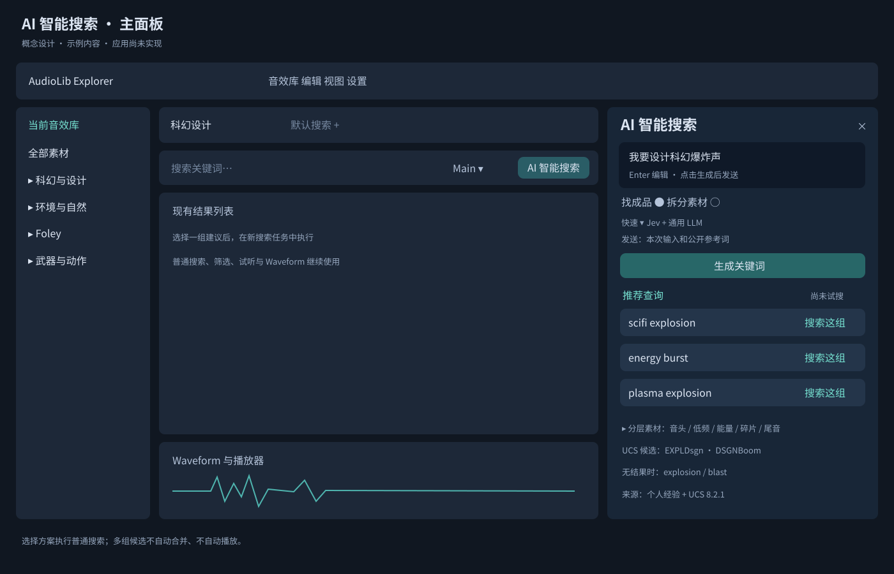
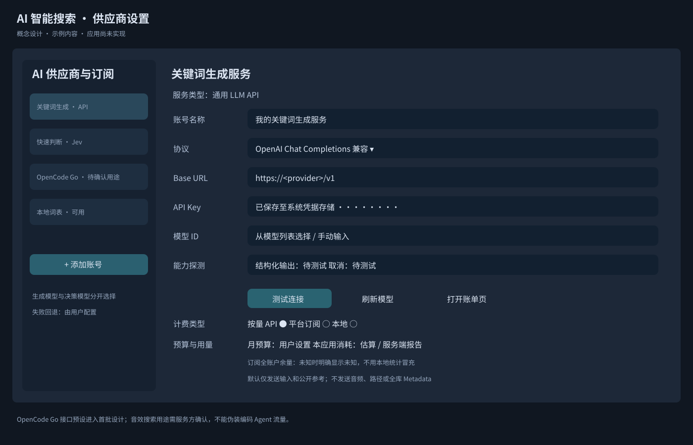
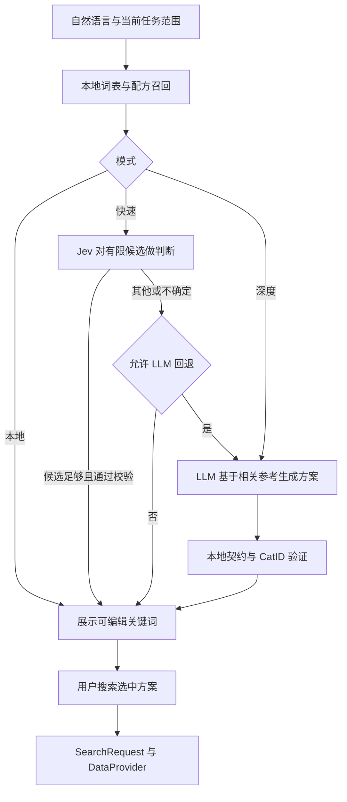

# AI 智能搜索开发方案

状态：研究与设计基线；本次实现的功能、边界和使用方式见 [Rust AI 搜索](Rust_AI_Search.md)。研究日期：2026-11-12。分支：`codex/ai-keyword-search`，创建基点 `a7606360e8df0ff1419130b2977272902db1e80f`。基点工作区已有其他未提交的搜索/UI 改动；这些改动不计作本次实现。

建议第一版实现“自然语言 → 可解释关键词方案 → 现有 FTS5 搜索”。复用个人经验和 UCS，先解决用户不知道该搜什么的问题。Jev 负责在候选中快速判断，通用 LLM 负责开放式意图理解和关键词组合。本地词表可独立使用。后续若有基于音频内容的需求，再增加音频 embedding；第一版不声称能够听懂缺少 Metadata 的音频。

## 1 交付物与知识组织

| 交付物 | 内容 |
| --- | --- |
| [Agent skill](../.agents/skills/audio-keyword-search/SKILL.md) | 简短入口、按需参考、默认输出规则 |
| [关键词数据](../.agents/skills/audio-keyword-search/data/keywords.jsonl) | 303 条个人记录加 128 条编辑扩展，共 431 条；保留原始行来源、并列词和歧义 |
| [UCS 数据](../.agents/skills/audio-keyword-search/data/ucs.jsonl) | 官方 8.2.1 的 82 大类、753 子类、CatID、英文和简中词汇 |
| [场景配方](../.agents/skills/audio-keyword-search/data/recipes.jsonl) | 19 种场景，成品、素材层、放宽策略 |
| [搜索技巧](../.agents/skills/audio-keyword-search/references/search-techniques.md) | 社区与专业资料归纳，附直接来源链接 |
| [快速检索](../.agents/skills/audio-keyword-search/scripts/lookup.ps1) | 本地只读、限量输出；无模型调用、无音库扫描 |
| [补全工作簿](../outputs/ai-keyword-search-20261112/AudioLib_AI_Keyword_Reference.xlsx) | 场景配方、关键词查询、官方 UCS、使用技巧、原始表快照 |
| [主界面设计](assets/ai-keyword-search-main.svg) / [供应商设计](assets/ai-keyword-search-providers.svg) | 概念线框；显示示例，不是运行截图 |

UCS 是公共领域的音效分类与文件命名体系，并非自然语言语义理解引擎。官方站目前展示 8.2.1，2024 年 1 月修正 `WOODHndl` 并扩展同义词。本次从官方资源读取完整数据，不从第三方列表猜测 CatID。[UCS 官方说明](https://universalcategorysystem.com/)、[官方资源](https://resources.universalcategorysystem.com/)

个人表提供比分类体系更有价值的制作语境，如 sweetener、bass drop、ring、foley 细节。保留这些经验，再增加规范词、查询变体、语义歧义和材料替代关系。`sliener gun` 作为历史拼写保留，优先词改为 `silenced gun` / `suppressed gun`；`drone`、`dry/wet`、`close` 按语境区分。

不将经验、官方分类和编辑建议混为同一权威来源。词表中空的 CatID 表示未映射；一个词可对应多个场景。官方同义词也是检索关联，不保证严格语义等价。运行时读取版本化 JSONL 或其派生紧凑索引，不依赖 Excel，也不在每次请求中传入全部 753 行。

## 2 当前项目约束

已检查 [core 搜索契约](../crates/audiolib-core/src/lib.rs)、[文本编译器](../crates/audiolib-db/src/search_text.rs)、[搜索任务](Rust_Search_Tasks.md)、[workspace](../crates/audiolib-core/src/search_workspace.rs)、[远程凭据实现](../crates/audiolib-remote/src/secrets.rs) 和 [Slint 窗口](../app/audiolib-desktop/ui/app-window.slint)。

| 现状 | 对 AI 功能的影响 |
| --- | --- |
| `SearchRequest.query` 是纯文本 AND | `explosion blast` 要求两个词均满足。替代词必须生成独立查询，不能输出 `OR` 表达式 |
| 引号/星号不是给用户使用的 FTS5 语法 | 不输出假短语搜索、通配符或原始 MATCH |
| 字母片段检索 | `wind` 可能匹配 `window`；精确度要通过更多条件和试听改善 |
| Main / All / Path / Filename 四种范围 | 当前范围随任务保留；AI 可建议用户切换，不能暗中扩大 |
| 标签包含/排除只作用于标签 | “不要人声”不能宣称已经全字段排除；没有相应标签时保留为建议 |
| 查询 500 字符上限 | 自然语言输入与执行查询分别校验；本版自然语言输入也限制 500 字符 |
| 每库最多 30 个搜索任务 | 多查询不能无界创建 tab；单个方案可开一个任务；显式批量入口最多开 5 个，名额不足整批拒绝 |
| workspace 有版本、身份与取消约束 | AI 请求绑定 library/provider/task/request/edit revision；过期回复不能改新任务 |
| DataProvider 返回 owned 值 | AI 不读 SQLite、不拼 SQL；查询仍经过 DataProvider |
| server 模式依赖验证后的只读快照 | 第一版 AI 在客户端生成查询，服务器协议和工作库 schema 不变 |

## 3 用户流程与 GUI

### 主入口

实施更新：按后续界面反馈，入口已改为搜索条内的 AI 激活开关与搜索／生成组合控件，普通与 AI 描述分别保留草稿。推荐查询集中在声音列表上方，以有边框标签提供快捷搜索，并支持一键创建前 5 个搜索任务。侧栏可收起为右侧 AI 按钮，保留当前页面和草稿；配置空名自动采用供应商与序号。具体界面和验证见 [Rust AI Search](Rust_AI_Search.md)。原方案建议的 `Ctrl+Shift+F` 仍属待规划项；普通 `Ctrl+F` 行为保留。



面板依次包含：自然语言输入；“直接找成品 / 拆分设计素材”模式；“本地参考 / 快速 / 深度”速度选择；本次将发送的内容摘要；生成按钮；可编辑的关键词方案；按层展开的补充查询。不要用聊天气泡占据主要工作区。

点击“生成关键词”仅生成方案。每条方案显示可复制的查询、简短理由和词表/UCS 来源。“搜索这组”将经过验证的词填入新搜索任务并执行一次；“替换当前查询”显式替换当前任务。用户可调整词后执行。默认不开启整批并行搜索、不自动开始播放。

原型中的示例不显示虚构命中数。未来可添加“试搜”以产生真实命中状态：未检查、查询中、确切数量或 `≥N` 下界。用实际 continuation 判断下一页，不把下界标成精确总数。若提供批量试搜，首版限制选择 3 组、最多 2 个并行 DB 请求，避免占满常规搜索 worker。

### 科幻爆炸示例

| 路径 | 可独立执行的查询 | 解释 |
| --- | --- | --- |
| 成品候选 | `scifi explosion`、`energy burst`、`plasma explosion` | 先找完整设计音效 |
| 低频主体 | `sub boom`、`bass drop` | 重量与冲击 |
| 冲击音头 | `metal impact`、`crack` | 清晰短瞬态 |
| 能量纹理 | `electric arc`、`plasma` | 科幻识别感 |
| 飞散碎片 | `metal debris`、`glass shatter` | 破坏细节 |
| 尾音 | `rumble`、`reverb tail` | 体积与空间 |
| UCS 补查 | `EXPLDsgn`、`DSGNBoom` | 适用于带 UCS 命名/Metadata 的库 |

先展示 3 条主查询，分层默认折叠，执行候选区最多 12 条。用户选择显示的层，避免一屏几十个标签。没有实库查询时所有候选都标注“尚未试搜”。

### 状态与交互验收

| 状态 | UI 行为 |
| --- | --- |
| 未配置供应商 | 本地词表模式可用；提供“配置 AI”入口 |
| 生成中 | 显示阶段与可取消按钮，结果表、播放器仍可用；不随每次按键发请求 |
| 方案就绪 | 可编辑、复制、搜索、保存为普通搜索收藏；显示生成供应商/模型 |
| 歧义 | 同屏并列含义，例如 drone 的无人机/持续音；最多一个澄清问题 |
| 零结果 | 提议去掉修饰或改查素材层；保留目录和过滤条件 |
| 401/403 | 显示凭据/权限问题，不自动反复重试 |
| 402/额度耗尽/429 | 显示额度或限速，遵守 Retry-After；允许本地模式，跨供应商需已开启策略 |
| 超时/离线 | 保留本地候选；网络请求取消后不再接受旧方案 |
| 切换库、关闭任务或退出 | 取消关联请求、丢弃迟到回复，不影响已有 Metadata 写入排队与关闭 draining |
| 历史方案 | 显示词表/模型版本；再次使用时重新验证范围、过滤器与真实身份 |

支持中英文即时切换、键盘焦点、Enter 搜索选定方案、Esc 关闭/取消、屏幕阅读器名称和 100/150/200% 缩放。输入时 Enter 的确切行为按单行/多行设计统一，不能在编辑文本时误发收费请求。

## 4 供应商 API 与订阅管理

使用“账号 Profile + 协议 Adapter + 模型 Capability + 计费类型”四层，避免每个模型都增加一套业务分支。通用 LLM 与 Jev 使用不同能力接口，不把 Jev 强行包装成聊天补全。

| 首批接入 | 协议/能力 | 交付范围 |
| --- | --- | --- |
| OpenAI | Responses，结构化输出 | 官方 API Key；模型列表与 schema 能力探测；[官方文档](https://developers.openai.com/api/docs/guides/structured-outputs) |
| 通用兼容服务 | OpenAI Chat Completions 兼容配置 | 自定义 Base URL、模型 ID、可选 models 列表；以 DeepSeek 为首个真实适配例；[DeepSeek 官方 API](https://api-docs.deepseek.com/) |
| Anthropic | Messages | 单独请求/错误/usage 解析，不假设 OpenAI 参数通用；[官方 Messages](https://platform.claude.com/docs/en/api/messages) |
| Google Gemini | 原生结构化输出 | 原生适配和 JSON Schema 子集探测；不要靠修改 URL 冒充同一协议；[官方文档](https://ai.google.dev/gemini-api/docs/structured-output) |
| OpenCode Go | 平台订阅 + API Key，多协议路由 | 首批提供预设、订阅/额度字段和连通性状态；音效搜索用途的生产资格待服务方确认，见下文 |
| TypeSafe AI Jev | System One API 的 Choice / Score / Noul | 候选分类、配方选择、是否需要 LLM 的判断；[官方入口](https://docs.typesafe.ai/introduction) |

自定义兼容服务可覆盖其他供应商，但“兼容”不等于已经验收。Qwen、Moonshot、MiniMax、OpenRouter 等可以作为用户自定义 Profile；只有实际通过对应模型的结构化输出、超时、取消与错误契约测试才标为已验证。首版不维护随时过期的静态模型排行榜。

### OpenCode Go 的实际边界

官方当前公开 API Key 和模型端点，也说明 Go 面向 OpenCode 及具有类似请求模式的编码 Agent。音效库自然语言查询不能据此认定符合订阅用途。本方案包含适配设计与订阅管理，但默认标为“用途资格待确认”；在服务方确认允许该应用流量前，不作为默认生产后端，也不通过伪造 coding prompt、客户端标识或会话来绕过限制。[Go 官方文档](https://opencode.ai/docs/console/go/)

实施更新：默认后端仍是本地词表，Go 的适用范围在配置中说明。移除曾阻断连通性检查的本地“用途确认”勾选门槛；应用自行设置的布尔值不能验证订阅资格。模型目录和实际模型测试分开，认证、额度及请求许可由官方 API 判定，真实客户端身份不变。

核查到的 API 基址为 `https://opencode.ai/inference/go/`；Responses、Chat Completions、Messages 等走各自协议路径，模型列表为 `https://opencode.ai/inference/go/v1/models`。客户端使用真实 `AudioLibExplorer/<version>` User-Agent 与本应用稳定的会话 ID（`x-opencode-session`），同一任务后续请求复用，不跨用户/库复用。端点作为有版本的预设维护，不从模型返回值改写。

官方页面目前列出 Go $10/月、Go Plus $40/月、Go Teams $20/成员/月，并按模型设置 5 小时/周/月窗口；这些仅是 2026-11-12 的文档快照，产品 UI 不硬编码承诺。`opencode.allowance` 是请求消耗信息，不可直接当成整个账户的剩余额度。存在官方余额/用量接口才同步全局值，否则显示“未知”并链接账户控制台。本地只统计本应用已知消耗。[同一官方计费说明](https://opencode.ai/docs/console/go/)

### 账号与设置界面



设置 → AI 智能搜索。左列账号列表，右列当前 Profile：名称、服务类型、协议、Base URL、API Key 状态、模型、能力探测、用途角色（生成/快速决策）、计费类型（按量/订阅/本地）、预算、连接状态。按钮为“测试连接”“刷新模型”“打开账单页”“删除本地凭据”。

添加账号流程：选择服务 → 输入密钥与必要端点 → 从已取模型中选择或输入 ID → 点击测试 → 选择用途。连接测试是用户明确发起的最小请求，事先标明可能计费。模型列表失败允许手动输入，但显示“未验证”；不要调用每一个模型测试。

订阅管理 MVP 管理应用配置与用量可见性，不代用户购买、续费、取消订阅。没有官方管理 API 时只打开官方控制台。月费、续费日、额度上限可人工填写并标“用户填写”；余额未知不能显示为 0。消费型聊天订阅与 API 资格分别记录，不能用账号已付费来推定 API 可用。

允许多个 Profile；分别选“关键词生成模型”和“快速决策模型”。可选自动回退，但必须选择目标 Profile、是否接受新增费用、是否允许将同一输入发送给另一家供应商。未启用时在当前供应商失败后回到本地词表。

## 5 Jev 路由与通用模型协作

Jev 返回带类型的判断，不能生成任意字符串。因此快速模式应由本地词表先召回有限候选，再让 Jev 选候选；候选不足或用户要求新组合时再交给 LLM。不要要求 Jev 直接发明完整关键词方案。[TypeSafe primitives](https://docs.typesafe.ai/introduction)



建议快速模式一次 Jev 请求中并行问独立问题：意图是成品还是设计素材；候选配方哪个最贴切；用户是否明确要求排除人声。每个问题只问一个判断，候选始终包含 `other_or_unclear`。多义 drone 不用一次选择强迫用户丢失一个含义，可展示两个候选；多层设计用多个问题/规则组合，而非一个 Choice 输出全部层。

API 为 `POST https://api.typesafe.ai/v1/systemone`，Bearer key；`GET /v1/models` 可发现模型。下列为按官方请求形状编写的适配草案，未调用收费接口；模型名配置化，生产优先固定已验收版本。[TypeSafe Quick start](https://docs.typesafe.ai/introduction/quickstart)、[官方 API](https://api.typesafe.ai/redoc)

```json
{
  "model": "jev-latest",
  "state": {"intent": "我要设计科幻爆炸声"},
  "questions": {
    "recipe": {
      "type": "choice",
      "instructions": "选择最符合需求的候选。不能确定时选 other_or_unclear。",
      "criteria": {
        "scifi_explosion": "能量、等离子或未来风格的设计爆炸",
        "real_explosion": "写实炸药、战争或现场爆破声",
        "other_or_unclear": "都不适合或信息不足"
      }
    }
  }
}
```

保留返回的模型版本、Choice 分布和 latency。`confidence` 是分布集中程度的统计量，不等于本领域正确率；不能直接显示“此搜索 95% 准确”。按中英声音设计测试集校准阈值，初始只用于决定“展示候选还是回退”，不作为权限、费用或数据安全闸门。[TypeSafe Confidence](https://docs.typesafe.ai/confidence)

Jev 是否真的降低端到端耗时必须比较“规则本地”“单次小 LLM”“本地 + Jev”“Jev + LLM 回退”四条路径，记录路由命中率与回退率。高回退率会增加一次网络往返；不因为供应商宣传快就默认在每次 LLM 前增加 Jev。

## 6 Rust 实现结构与数据契约

建议新增 `crates/audiolib-ai`，拥有参考库检索、LLM/Jev adapters、方案验证与网络预算；`audiolib-core` 定义 owned 的轻量 `AiQueryPlan` / `AiProviderConfig` / `AiCapabilities` / `AiUsage`。desktop 是组合根，持有配置和任务身份。core 不依赖网络 SDK，db 不依赖 AI。

| 位置 | 拟议改动 |
| --- | --- |
| `crates/audiolib-core/src/ai_search.rs`（新增） | 方案、候选、排除建议、能力/配置 DTO 与验证 |
| `crates/audiolib-ai/src/reference.rs`（新增） | 版本化资料索引；优先中文触发、英文别名、配方与相关 UCS；总上下文预算 |
| `crates/audiolib-ai/src/provider/`（新增） | Responses / Chat Completions / Messages / Gemini / TypeSafe adapters |
| `crates/audiolib-ai/src/planner.rs`（新增） | 模式路由、取消、有限回退、输出验证、缓存 |
| `app/audiolib-desktop/src/ai_search.rs`（新增） | task generation 与后台请求调度，回传 Slint event loop |
| `app/audiolib-desktop/ui/ai-search-panel.slint`（新增） | 面板、建议卡、分层查询、状态与可访问性 |
| desktop 设置 UI / `config.rs` | AI Profile 非机密设置与有序保存；迁移默认关闭网络 AI |
| 新凭据模块 | 与远程音库密钥隔离的凭据空间；共用经审查的底层保护机制 |

接口按能力分开，例如 `QueryPlanner::plan(intent, refs, context)` 与 `DecisionProvider::evaluate(state, questions)`。使用可替换 HTTP transport 便于 mock。根据项目现有 runtime 选异步 transport；如果继续使用 blocking reqwest，则必须独立的有界 worker，且明确中止/超时语义，不能在 Slint 或音频回调里等待网络。

`AiQueryPlan v1` 参考 [输出契约](../.agents/skills/audio-keyword-search/references/output-contract.md)。模型只能提出文本、层、UCS 候选与过滤建议；真实 scope/folder/task/library ID 由客户端绑定。任何模型提供的路径、命令、URL 或新身份不得进入查询执行链。普通关键词搜索保持唯一最终入口。

通用 LLM 请求只带当前自然语言、少量相关词表/配方和输出 schema。参考预算建议上限 6,000 input tokens，输出上限 1,200 tokens，按真实供应商 tokenizer 或保守估计留余量。所有供应商输出仍需本地验证；结构化输出支持 schema 子集，拒答、截断与语义错误都要处理，不能只以 JSON 可解析作为成功。[OpenAI 结构化输出](https://developers.openai.com/api/docs/guides/structured-outputs)、[Gemini 结构化输出](https://ai.google.dev/gemini-api/docs/structured-output)

### 取消与迟到回复

请求上下文包含 `(library_identity, provider_generation, task_id, ai_request_id, input_revision, reference_version, profile_revision)`。输入修改、切换库/任务、Profile 更新、面板取消均取消旧请求；返回 UI 前逐项比较。新任务容量满时允许复制或明确替换当前任务，不静默覆盖。正常音频播放、Waveform、Metadata 写入顺序和关闭 draining 保持原职责。

### 多查询与排序

MVP 每次执行用户选中的一条普通查询，直接沿用现有分页/排名。不会把多个查询各自的 BM25 数值直接比较。后续若需要“全部搜索并合并”，新增单独设计：每路限制候选数、按文件稳定 ID 去重、RRF 或明确融合策略、独立 continuation 状态，以及“部分合并结果”提示；不能把几页合并称为全库精确总数。

### 保存与缓存

本机 `AUDIOLIB_DATA_DIR` 下 `ai/` 保存版本化非机密配置、可清理缓存和本应用 usage ledger；遵从现有自定义数据目录，不固定到开发路径。AI 方案历史第一版可仅内存保存；用户明确保存的普通查询进入现有搜索收藏。若以后持久化 AI 草稿，放独立版本文件并遵守 instance lease、原子写入与未知版本保护，不顺手修改 workspace 格式。

缓存 key 包括规范化输入、明确约束、参考版本、prompt/schema 版本、供应商和模型版本、语言及相关 scope 上下文。只缓存关键词方案，不缓存完整库结果；回用仍校验身份。用户清除历史时同步清除含文本的 AI 缓存，usage ledger 只保留数值摘要。默认关闭云端同步和全文诊断日志。

## 7 凭据、隐私与费用

Profile 只保存 `credential_ref`，不保存明文 key。Windows 可复用 DPAPI 底层实现思路；当前 remote 模块在非 Windows 平台采用 owner-only 文件，不能称为已具备 Keychain。macOS 客户端的 AI 密钥应新增 Keychain 后端；不可用时提供仅会话密钥。不要为此迁移或覆盖现有服务器 token/WebDAV password。

默认网络只发送用户输入和公开参考片段；不发送音频、完整路径、全库列表、用户注释、库名或服务器地址。未来若开启“根据库词频调整”，先在本地聚合并让用户查看将发送字段，再纳入独立开关。界面显示本次具体供应商与数据范围，不暗中把失败请求转发到另一家。

Base URL 只来自已保存配置；解析 scheme/host，禁止 URL 中 userinfo 与 key query，阻止把 Authorization 随跨域重定向发送。云端默认 HTTPS；用户明确配置的本地推理 HTTP 可作为单独本地类型。模型输出永远不能重定向请求地址。错误文本脱敏，不记录 prompt、响应正文和密钥；报告仅含枚举错误、时延、模型标识和用量。

usage ledger 按 request ID 去重，记录 provider/model、输入/输出 token、缓存 token、价格快照与币种、服务端报告花费或估算值、状态与日期。订阅余量、现金支出、本应用估算消耗分别显示。月度预算检查“已花费 + 在途预留 + 本次上限”，并发不能绕过；价格未知时用户设置请求数/并发硬上限。

超时建议：连接 5 秒、快速判断 3 秒、LLM 15 秒，均可调整并明确为初始产品参数。最多一次符合服务端指示的安全重试；请求可能已计费的网络中断不盲目重发。每个交互的最大模型调用次数建议 2（Jev + LLM，或 LLM + 一次格式修复），超过预算即返回已知候选或具体错误。401/403/402 不自动重试。

## 8 质量评估与性能目标

先建立 120 条中英需求测试集：40 个成品事件、30 个分层设计、20 个多义/口语、15 个排除/范围、15 个恶意输入/超长/离线等边界。由声音设计者标注“可接受关键词集合、禁止错误、可用素材层”，不是只要求匹配某一段固定文字。用个人库试听结果补充标注，测试 fixture 不覆盖工作数据库。

| 指标 | 建议验收门槛或测量方式 |
| --- | --- |
| 执行安全 | 所有进入执行的方案通过本地校验；无原始 SQL、伪 CatID、越权库切换 |
| 关键词可用率 | ≥90% 需求在前 3 组中至少有一组经人工认为可用；这是待验收目标 |
| 核心意图保留 | 写实/设计、无人机/持续音、干湿语义等关键错误单独计数，不被均值隐藏 |
| 无效输出 | 统计首次有效 schema 比例、拒答、截断、修复与失败；最终无效输出不能执行 |
| 本地模式 | P95 生成建议 <100ms 的开发目标；用实际硬件测量 |
| 快速/深度模式 | 初始体验目标分别 P95 <1.5s / <5s；含网络、路由、解析和 UI，不承诺已达到 |
| 原搜索性能 | 保持 **P95 latency <500ms for 1M+ records**；AI 网络耗时单列，不能混入或冒充 DB 指标 |
| 成本 | 每 100 次成功请求的实测用量、回退率、取消后计费情况；不只报模型标价 |

对照基线为：用户原词直搜、个人词表本地规则、普通小 LLM、Jev 选择、Jev+LLM。不要只与空白无提示模型比较。报告 p50/p95、冷/热缓存、所在地网络、模型版本、词表版本和真实成功率。当前研究只验证参考数据和脚本，不代表模型效果或实库性能已验收。

## 9 开发拆分与检查范围

以下按单开发者估算工程工作量，不是交付日期承诺；供应商用途资格和账号条件不计入编码耗时。

| 阶段 | 内容 | 估算 | 完成条件 |
| --- | --- | --- | --- |
| P0 | 本次 skill、补全表、来源与方案 | 本次交付 | 数据/脚本/文档检查通过 |
| P1 | core 契约、词表索引、本地模式、主面板 | 3–5 人日 | 无账号可用；查询语义、任务身份、取消与键盘路径通过 |
| P2 | Profile/密钥/预算 + 通用 LLM adapters | 5–8 人日 | 首批官方服务各选一个模型通过最小真实验收；其他兼容项明确未验证 |
| P3 | Jev 决策、回退、OpenCode Go 预设与订阅状态 | 3–5 人日 | Jev 基准与费用可见；Go 技术与用途资格分别报告 |
| P4 | 120 条评估、视觉与异常回归、打包安装 | 3–5 人日 | 实际 shipped feature 验收与固定 local_release 更新 |

建议先完成 P1+一种通用兼容协议形成垂直切片，再扩展原生 adapters；第一批完成 P1–P4 后才对用户宣布完整供应商支持。采用 feature/config 开关分阶段上线，尚未实现的入口不显示可用。

未来代码验证按仓库实际影响选范围：core/ai 单元和协议 mock，desktop 的输入/取消/任务切换回归，相关 direct consumers；严格 Clippy 与一次 fmt。配置持久化或跨实例路径变化触发相应 `validate-review-fixes.ps1`；关闭 draining 改动才加 `validate-desktop-close.ps1`。只有搜索/多路查询性能路径真正变化时才跑相关百万条性能验收，不能因为名字叫搜索就重复全部子系统。

最终应用交付仍按仓库规则完成实际 feature 的 release build、package、一次 portable acceptance、固定 `local_release/` 安装和 SHA256/隔离启动验证，随后预算化缓存维护。本次只生成 skill 与文档，不运行 Cargo、不重建或安装未改动二进制。

## 10 待实施时确认的产品项

1. Go 服务方是否允许音效库自然语言请求；如果不允许，平台订阅框架保留并选明确允许该场景的服务。
2. 默认云端服务由用户账号、网络实测和成本决定；模型选择不固化为当前名称排行榜。
3. 首版默认“生成后选择搜索”，是否提供单击自动采用最高候选作为后续可选设置。
4. macOS Keychain 后端、用户指定本地 HTTP 推理端点的验收范围与跨平台凭据行为。

相关研究来源集中于 [skill 来源说明](../.agents/skills/audio-keyword-search/references/sources.md)。供应商事实以本方案各节直接链接的官方文档为准，实施时重新核对端点、模型资格、价格和 schema。
