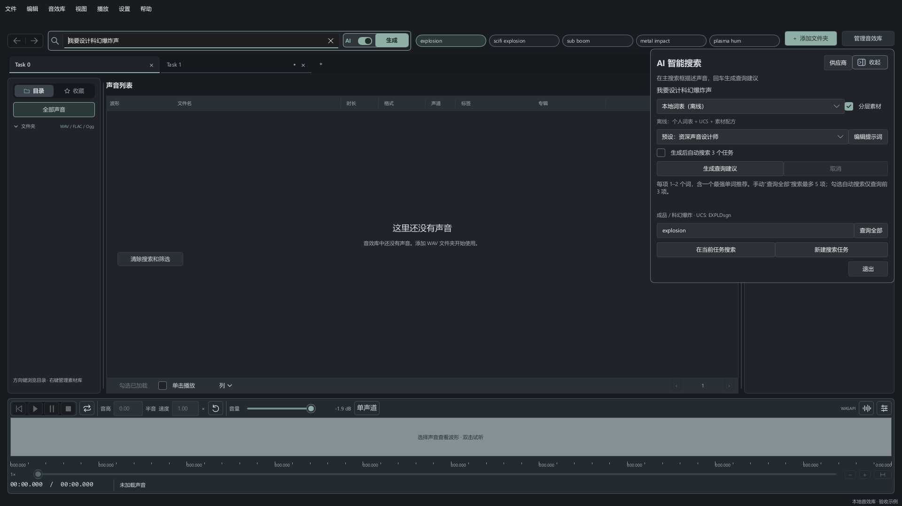

# AI 智能搜索

实现分支：`codex/ai-keyword-search`。Classic / Studio 的搜索条随窗口扩展；右端把 **AI 激活开关与搜索／生成按钮** 合为一组，历史导航在搜索条左侧。搜索条首选宽度从 840 调整为 560，最大宽度从 1160 调整为 773（均乘 UI 缩放），减少约三分之一。运行时由 Rust、Slint 和现有 FTS5 搜索组成，不依赖 Excel 或 Python。

## 使用

1. 开启搜索条中的 AI 开关，主搜索框切换为自然语言描述，首次使用选择“本地词表（离线）”，已有配置时恢复最后保存的供应商。输入“我要设计科幻爆炸声”，按回车或点击“生成”，立即显示“生成中…”状态，持续到候选命中核验完成。关闭 AI 开关恢复普通关键词输入；两种模式在当前会话分别保留输入草稿。侧面板不再另设自然语言输入框。
2. 勾选“分层素材”时，除 `scifi explosion` 等成品查询，还会给出低频、冲击、能量等素材查询。每一行独立执行，空格仍是现有搜索的 AND 语义。
3. 最多 5 个经过实际检索核验的推荐词显示在主搜索框右侧，点击即在当前任务搜索，并在侧栏显示词条来源和 UCS CatID，可直接编辑关键词。“在当前任务搜索”执行现有搜索；“新建搜索任务”继承当前任务的目录、搜索范围和筛选条件。选中推荐后可继续用左侧目录过滤，保留整组推荐及选中项；再次点击推荐或“查询全部”使用当前目录和筛选条件。某个子目录没有命中不代表整库无结果，不会因此删除推荐。
4. 需要云端理解时，在“供应商”新增配置，选择供应商并填写 Base URL 和 API Key，点击“获取模型列表”。**无需先保存，也无需先填写模型 ID**。列表返回后选择模型，也可直接手填模型 ID。“测试模型调用”使用固定 wind 示例验证认证、生成和结构化解析，会消耗供应商额度；已保存配置计入其本地请求上限。测试成功后保存配置，返回搜索页选择它并生成。公开模型列表不代表密钥或订阅已验证；获取列表不会保存草稿或消耗生成额度。

模型获取使用当前表单；未输入新密钥时，只允许复用同一已保存配置、同一协议和同一地址的密钥。认证失败会显示 HTTP 401，保留草稿以便修改重试。成功获取列表只证明模型目录接口可达，不保证具体模型的生成权限或账户余额。

提示词预设默认是 **“作为资深声音设计师，请根据输入内容，合理匹配声音设计需要用的专业Keyword”**，按用户要求原文保留。在建议面板可选择默认或自定义预设，展开“编辑提示词”修改，最多 2000 字符。修改立即用于下一次远程 AI 请求；“保存提示词”原子保存到当前数据目录，重启后保留。切回默认不会丢失最后保存的自定义内容。提示词与具体声音描述分开，也不绑定某个供应商。离线词表不执行自由文本提示词。

通用 LLM 将该提示词和固定 JSON 查询契约一起使用。Jev 将其用于配方 Choice 的角色与匹配指导，仍然只返回既有候选，Score / Noul 结构和查询校验不受提示词改写影响。

以下为隔离测试数据下的实际 Slint 渲染；[Studio 搜索条](assets/ai-search-studio-runtime.png)、[供应商与模型获取](assets/ai-provider-runtime.png) 和 [预设提示词编辑](assets/ai-search-prompt-runtime.png) 也已检查。

离线知识包括 431 条关键词、753 条 UCS 子类和 19 个场景配方，版本 `1.0.0-UCS8.2.1`，来源见 [研究与设计](AI_Keyword_Search_Design.md) 及 [skill](../.agents/skills/audio-keyword-search/SKILL.md)。离线匹配是关键词与配方排序，不能替代通用语言模型；未匹配时可简化描述或选择云端配置。

## 协议与供应商

| 协议 | Base URL 示例 | 处理方式 |
| --- | --- | --- |
| OpenAI compatible / Chat | `https://api.openai.com/v1`，或兼容供应商自己的地址 | `/chat/completions`，JSON mode，完整输出后校验 |
| OpenAI Responses | `https://api.openai.com/v1` | `/responses`，严格 JSON Schema，`store=false` |
| Anthropic Messages | `https://api.anthropic.com/v1` | `/messages`，强制 `emit_search_plan` 结构化工具输出 |
| Google Gemini | `https://generativelanguage.googleapis.com/v1beta` | `generateContent`，JSON Schema |
| Jev TypeSafe | `https://api.typesafe.ai/v1` | `/systemone`，有限候选结构化决策 |
| OpenCode Go | `https://opencode.ai/inference/go` | Go 的 Chat 接口；Console 个人 API Key |
| DeepSeek 官方 | `https://api.deepseek.com` | `/models` 获取当前模型；`/chat/completions` 使用 JSON mode 和格式示例，关闭 thinking 以用于快速关键词扩展 |

模型列表来自供应商实时返回，允许手填模型 ID；不把研究时价格、型号或账户余额硬编码。兼容接口需支持 JSON mode；不兼容时明确返回错误，没有无声降级或换供应商。普通产品订阅不自动等同于 API 权限。

DeepSeek 接入按 [官方接入地址](https://api-docs.deepseek.com/)、[模型列表](https://api-docs.deepseek.com/api/list-models/)、[JSON 输出](https://api-docs.deepseek.com/guides/json_mode/) 和 [thinking 开关](https://api-docs.deepseek.com/guides/thinking_mode/) 实现；模型 ID 以账户实际返回的列表为准。

Jev 接收本地检索出的最多六个配方，以及 `other_or_unclear`。三个问题各有明确类型：

- **Choice**：选一个既有配方；答案必须属于提交的候选 ID 集合，概率分布必须完整、有限且归一。
- **Score**：按 0–2 有序标准评估匹配；检查数值、置信度及概率键。
- **Noul**：估计是否需要澄清，取值 0–1，不能按普通聊天文本或 Choice 的置信度解释。

当前接受条件是 Choice confidence ≥0.65、Score ≥1.25、Noul <0.5，且不选 `other_or_unclear`。这些是应用策略阈值，尚未经实际音效语料校准，不代表保证准确率。通过后由本地配方确定查询，Jev 不能生成任意关键词。未通过时保留用户控制，不自动调用另一个收费 LLM。

OpenCode Go 使用已订阅工作区的 Console 个人 API Key；模型列表请求为 `/inference/go/v1/models`，生成请求为 `/inference/go/openai/v1/chat/completions`。亦接受 SDK 示例中的 `/inference/go/openai/v1` Base URL，以及 `opencode-go/<model-id>` 名称，发送前只规范路径和模型前缀，不改变凭据所属主机。旧 `go_use_authorized` 字段保留以读取既有配置，不再作为客户端请求门槛。用户报告的“用途尚未确认”来自这个本地门槛，并非供应商返回的认证失败。

官方将 Go 定位为编码 Agent 服务，本应用如实声明 AudioLib User-Agent 和稳定的 `x-opencode-session`，不伪装为 OpenCode。供应商是否接受音效检索请求仍由其规则和账户权限决定；应用不购买、续费、取消订阅或修改额外付费选项。依据：[Go 官方配置](https://opencode.ai/docs/console/go/)、[Inference API 认证](https://opencode.ai/docs/console/api/inference/)。

生成推荐后，先使用当前目录、搜索范围和筛选条件实际检索候选；跳过没有结果的方案，每个推荐最多包含 2 个英文关键词，最多保留 5 个有结果的不同查询，不足 5 个时显示实际有效数量。至少保留一个单关键词方案并置于首位，优先采用模型／词表排序最靠前的单词候选；模型只返回词组时，从优先级靠前的方案提取核心声音词并再次验证；词组没有结果但核心单词有结果时，仍保留这个单词方案。这里的置信度使用候选排序，不显示未经校准的概率。推荐标签位于主搜索框右侧的同一顶栏，短窗口可以横向滚动，不占用声音列表高度。“生成后自动搜索 3 个任务”默认不勾选；生成只显示备选，勾选后按最前面的最多 3 个有效推荐新建独立页签，逐个查询并缓存结果，完成后返回第一项。手动切换、修改查询或取消会停止自动批次。侧栏查询框旁的“查询全部”对当前每个推荐 tag 各新建一个独立任务并逐项查询，最多 5 项；自动模式仍最多 3 项。任务名额不足时整批拒绝，不部分创建。关闭 AI 模式仍可保留同一检索条件下已核验的标签；目录、范围或筛选条件变化后，旧推荐不能用于新条件，需要重新生成。编辑声音描述、更换供应商或取消建议会使推荐失效。点击已有标签和批量搜索不再次调用供应商。同一条件下后续查询确认某个推荐已无结果时，移除该 tag；保留用户自定义输入和其他任务。若移除后无法保留单关键词方案，则清空旧方案并提示重新生成。

AI 面板顶部使用带右向箭头的侧栏图标和“收起”文字，收起后在窗口右上方显示带左向箭头与“展开 AI”文字的按钮；点击即可重新展开。入口随工作区顶栏垂直滚动，顶栏滚出视图时隐藏，滚回后恢复；横向位置仍位于窗口右侧。收起保留 AI 模式、当前页面、表单和推荐；展开面板不再显示“×”；底部“退出”关闭 AI 模式。普通搜索侧栏采用紧凑高度，展开提示词或进入供应商页时增高。搜索表单内部可滚动，底部查询输入框、旁边的批量新建按钮、下方两颗搜索按钮和“退出”固定保留，在短窗口或较大 UI 比例下仍可操作。当前状态和数据源状态统一放在原生窗口右下角，不随工作区滚动；长文本省略并保留完整提示，数据源仍可点击打开配置。底部不再显示格式列表说明。

## 配置、边界和取消

- 配置文件位于当前 `AppConfig::data_root()/ai/profiles.json`，遵循已有桌面实例锁。Windows 密钥使用当前用户 DPAPI，与配置在一次原子替换中保存；不写入 `settings.json`、日志或普通导出。其他平台当前只保留会话密钥。
- 留空密钥表示保留；勾选“清除已保存密钥”移除。更换协议或地址必须重新输入密钥或明确清除，以免把旧密钥发送到新主机。未知版本或损坏配置不会被空配置覆盖。
- 空白配置名称自动使用“供应商 + 序号”（例如 `OpenCode Go 1`），避免与已有名称冲突；用户填写的名称保持原样。配置草稿按 profile ID 在会话内保留，切换页面、收起、关闭并重新打开面板或切换供应商均可恢复；只有“保存配置”写盘，退出应用不保存未提交草稿。“重置草稿”恢复已保存值。重复选择同一协议不再重填默认地址或清空密钥。
- 保存按钮固定在配置页底部；密钥输入留空时显示“密钥已保存（隐藏显示）”，不会把加密凭据或伪装星号填回表单。提示只是存储状态，不代表认证通过。首次加载恢复最后保存的供应商；没有保存配置才回到离线词表。
- 最多 16 个配置，每次只允许一个在途 AI 操作。网络在独立后台线程执行，2–60 秒超时，不跟随重定向，响应最多 512 KiB。远端只接受 HTTPS；HTTP 仅允许显式 loopback。
- 默认不发送音频、文件路径或当前音库 Metadata，只发送用户描述、选用的提示词和有限公共/个人参考条目。用户主动写进描述或提示词的内容会随请求发送。
- 每月请求上限是 **本应用按 UTC 月份统计的生成尝试次数**，不是供应商额度；模型列表查询不计入。先持久化计数再发送，失败和超时也计入；不自动重试。Token 数只记录成功解析结果里供应商报告的数值，不是账单。余额为未知。
- 取消立即使结果失效；底层阻塞 HTTP 可能等待到超时才释放单个请求槽。关闭窗口不等待网络请求；已接受的配置保存会先排空。在途响应仍检查完整搜索上下文。已完成建议绑定描述／供应商修订和资料库／数据源身份，允许目录过滤、范围变化、预览刷新、分页及任务导航后再次搜索；原始生成条件保留为命中核验依据，只有同一核验条件下完成的零结果检索才移除失效推荐。更换描述、供应商或资料库／数据源后需重新生成。
- 供应商原始输出最多 12 个候选；桌面将每项收窄到最多 2 个关键词，经实际命中核验后最多展示 5 个不同方案。意图和原始查询最多 500 字符。拒绝布尔表达式、SQL 分隔符、无效结构、伪造 CatID 或来源 ID，以及截断/拒答结果。模型不接触 SQL 或库写入 API。

## 代码与验证

`audiolib-core::ai_search` 定义有界 DTO 和查询规则；`audiolib-ai` 负责离线检索、协议、Jev 解析和配置存储；桌面 `ai_search.rs` 负责后台操作、状态代际、保存排空和 Slint 发布。数据库 schema、扫描、播放及音频回调不变。搜索性能目标仍是 **P95 latency <500ms for 1M+ records**；模型网络耗时单独计算。

新增回归覆盖离线中文与歧义查询、出处校验、不同协议解析、Jev 类型/数值/候选约束、HTTP 重定向与取消、密钥保存、请求上限、提示词持久化，以及真实 GUI 回调到现有搜索任务的隔离流程。真实供应商调用需要用户自己的 API 权限，不能用本地 mock 结果声称端到端联网验收通过。

2026-11-12 首次交付验证记录（Windows x64，Rust 1.97.1 MSVC，0.9.5 开发工作区）：

| 范围 | 结果与证据 |
| --- | --- |
| AI 后端 | strict Clippy；10 项测试通过，含预设原文进入 Chat/Jev 请求、自定义提示词切回默认后仍保留。日志 `.rust-validation/ai-prompt-clippy.log`、`ai-prompt-tests.log` |
| core | 201 项单元测试、2 项路径集成测试通过；相关源码随后未变，复用 `.rust-validation/ai-core-tests.log` |
| 桌面 ASIO | 格式检查及最终 strict Clippy 通过；开关与双草稿、面板/预设、Controller 搜索与持久化、菜单、对话框、搜索历史共 6 项针对性回归通过。日志 `.rust-validation/ai-final-*.log` |
| 其他桌面回归 | 较早的同分支 ASIO 包测试 600 项通过；后续界面调整另按上行范围重验。原始记录 `.rust-validation/local-checks/efdd652b42b44aa29576db2814f63be6/asio-tests.log` |
| 崩溃诊断环境差异 | 包测试另有 1 项在网络盘运行含大型 debug PDB 的测试时超过 10 秒而失败。未修改测试，将同一 EXE 和 PDB 复制到本机临时目录后独立运行，0.87 秒通过；临时副本已删除。记录证明两种运行环境的结果差异，未单独定位到 PDB 读取。日志 `ai-panic-local.log` 和身份记录 `ai-panic-local-identity.json` |
| 发布构建 | Windows client 许可证预检和 MSVC ASIO release 构建通过，版本 0.9.5；使用分支当前未提交工作区。日志 `.rust-validation/ai-delivery/licenses.log`、`build.log` |
| 配置与关闭 | `validate-review-fixes.ps1 -CleanCheckout` 和 `validate-desktop-close.ps1` 通过；均使用隔离 fixture，没有验证真实 legacy 数据库或打开音频输出。日志 `.rust-validation/ai-delivery/review-fixes.log`、`close.log` |
| 便携包 | 打包与 `validate-portable.ps1` 通过，覆盖 EXE 身份、隔离首次启动、合成 WAV 扫描、CLI、中文 GUI、错误配置诊断及许可证。日志 `.rust-validation/ai-delivery/package.log`、`portable.log` |
| 固定安装 | `local_release/` 已更新；908 个包内文件哈希一致，CLI 为 `AudioLibCli 0.9.5`，桌面隔离启动通过。安装证据 `.rust-validation/local-install/b5887c7ae71741ab8df2b20af7886973/report.json`；现有用户数据与偏好保留 |
| 构建缓存 | 安装后执行 `clean-build-artifacts.ps1 -Action Run` 通过；清理约 4.39 GiB，剩余约 39.99 GiB（逻辑大小），40 GiB 预算达标，保留 release 和安装产物。日志 `.rust-validation/ai-delivery/cache.log` |
| 真实供应商 | 未提供账户 API Key，未进行付费调用；OpenAI/兼容服务、Anthropic、Gemini、Jev 与 OpenCode Go 的真实账户联调尚未验收 |

AI/core 测试独立运行；桌面以 ASIO 特性运行。把纯 AI 测试包和桌面一起启用 ASIO 会使测试包继承 Windows shim 特性、却没有音频宿主链接，因此不采用该混合测试目标。实际桌面 ASIO 构建本次已通过。

本次本地交付使用 `local_release/Start-AudioLibExplorer.cmd` 启动。它是功能分支工作区构建，没有创建标签或发布 GitHub Release。

### 1.0.0 本地候选的后续修正

按用户要求提升工作区版本及内部包锁文件版本为 1.0.0；API、schema 和资料库格式不变。升级比较回归确认 0.9.x 与同版本不会触发更新，未来 1.0.1 仍可正常提示，旧版本安装标记与新 EXE 不匹配时仍拒绝使用。

本轮改动为搜索控件布局、未保存配置的模型获取、DeepSeek 官方协议和本地版本标识。AI 后端 12 项回归、升级比较回归、AI/update/桌面严格 Clippy，以及面板、开关、未保存供应商获取／认证失败重试、查询应用／过期结果、历史导航共 5 项桌面回归已通过。最后仅校正历史导航垂直对齐，两项界面回归再次编译通过，实际 Classic／Studio 渲染已检查。OpenCode Go 官方公共模型目录的只读检查返回 `object/data` 和 30 个模型 ID；这不验证账户密钥或生成权限。当前记录位于 `.rust-validation/ai-provider-ui/`。

编译期间网络盘旧 `.rmeta` 文件曾返回写入拒绝；两份 SQLite 派生文件保留在 `cache-recovery/` 后重新生成，相关检查恢复通过。未修改源代码来绕开检查，也未重置目录权限。

1.0.0 本地交付已完成 Windows MSVC ASIO release 构建、许可证预检、便携打包及 `validate-portable.ps1` 隔离启动验收。固定安装 `local_release/` 的 908 个包内文件哈希一致，CLI 为 `AudioLibCli 1.0.0`，`update-version.txt` 为 `1.0.0`，安装后的桌面隔离启动通过。交付日志位于 `.rust-validation/ai-provider-ui/delivery/`，安装身份记录为 `.rust-validation/local-install/9a3e6d1b8b6c48c1b24c611098d647f7/report.json`。没有创建发布标签或上传 GitHub Release。

交付后的缓存维护首次遇到网络盘“目录不是空的”，确认无运行中编译器／应用后，仅重试维护步骤并通过。维护前后逻辑大小约 63.38 → 3.73 GiB，减少约 59.65 GiB，40 GiB 预算达标；release、安装、SDK、源码、音频和数据保留。证据为同目录 `cache.log` 与 `cache-retry.log`，该空间数值是逻辑估算。

复用首次交付中配置原子写入、关闭排空和扫描交叉进程回归的通过证据（`.rust-validation/ai-delivery/review-fixes.log`、`close.log`）：本轮没有修改这些持久化／并发流程、数据库／音频契约及 feature，仅增加读取当前供应商草稿的请求路径；新增配置获取与保存流程另由针对性 Controller 回归覆盖。共享版本元数据变化不改变这些稳定模块的行为。

### 1.0.0 连续搜索与快捷入口修正（2026-11-12）

用户反馈首次“在当前任务搜索”成功、预览期间第二次操作失败。旧应用判断要求已完成建议的搜索 generation 始终相等，结果刷新会误将同一描述的建议判为过期。修正后，在途响应仍严格校验上下文；已完成建议允许同库内的结果刷新、分页及任务导航，描述/供应商取消修订和资料库/数据源边界仍生效。AI 关闭后保留已完成的 5 个快捷查询，不追加供应商请求。

本轮 `cargo fmt`、AI 与桌面严格 Clippy 通过；AI 后端 13 项测试、桌面 ASIO 的 6 项针对性回归通过，日志在 `.rust-validation/ai-quick-search/`。回归覆盖 Go 默认未勾选配置的请求、官方 SDK URL/模型前缀、真实 User-Agent/会话头、获取模型与固定示例调用分离、保存前草稿测试、认证失败重试、保存后请求额度记录，以及连续搜索/模式切换/五个快捷按钮。预览回归加载隔离 WAV，刷新结果后反复搜索，验证加载 generation 与 play session 不被搜索改变；未开启真实音频设备输出。Classic/Studio 和供应商面板的实际 Slint 截图已检查并更新。

复用此前 core、数据库、配置原子写入、关闭排空和扫描交叉进程的通过基线（见上表）：本轮没有修改其行为、存储格式、依赖或 ASIO 后端；模型测试复用既有串行 ProfileStore 和额度预留流程，新增行为由 AI 存储与 Controller 测试覆盖。未重跑不相关的全工作区测试或百万记录性能验收。真实 Go 订阅及其他供应商账户的付费调用尚未验收；公共目录不作为认证证据。

本轮交付完成：Windows ASIO 优化构建（13m04s）、许可证预检、便携打包及 `validate-portable.ps1` 均通过。固定 `local_release/` 已更新为本功能分支工作区的 `AudioLibCli 1.0.0`；908 个包内文件哈希核验通过，隔离桌面启动通过，安装证据为 `.rust-validation/local-install/cd0e61e21d2645c4a98ec6a75c9fe7f9/report.json`。构建、验收和安装日志在 `.rust-validation/ai-quick-search/delivery/`。安装后缓存维护通过，逻辑大小约 22.33 GiB，处于 40 GiB 预算内，本次无需删除缓存；release、固定安装和用户数据保留。未创建标签或发布远端版本。

### 1.0.0 配置草稿与中区关键词改版（2026-11-12）

界面重开问题由三个状态处理共同造成：冷加载没有恢复已保存选项、关闭时清空输入密钥，以及重复选择同一协议会重新应用预设。修正后保存状态与会话草稿分开，草稿按 profile ID 关联；未保存密钥仅在进程内保留。已保存密钥存在与否通过布尔状态显示，不解密回填。底层 `profiles.json` 格式、DPAPI、原子替换和桌面实例锁均沿用现有实现。

推荐标签从顶部快捷行和侧栏列表集中到声音列表上方；可收起侧栏、查看全部推荐，并显式创建前 5 个搜索任务。创建先检查全部容量，使用同一当前任务定义，随后走既有任务恢复流程。数据库、扫描、播放、Metadata 写入及音频回调没有修改。

本轮源代码验收通过：最终格式与桌面 ASIO strict Clippy、AI 后端 strict Clippy 和 14 项测试、10 项相关桌面交互回归（含目录/标签/搜索范围继承、容量不足整批拒绝、配置草稿/自动命名/已保存选择恢复、连续预览期间搜索、标签布局与紧凑窗口），另复用 3 项页签回归。Classic、Studio、侧栏收起和供应商页的实际 Slint 截图已目检。页签证据在 `final-ui-tests.json` 保留原测试 EXE 哈希；随后修改只涉及 AI 区域内部定位、滚动、固定底部控件和测试，未改变页签宽度、字体、结构或行为。

展开态补验：1080×700、中英文、100%/150%/200% UI 比例及长 detail/status 共 6 组真实按钮点击通过，最终截图已检查（`final-layout-ui.log`、`final-layout-snapshots/`）。表单内容可滚动，查询与执行按钮固定在下方；状态文字有明确高度上限，保留开头并按宽度换行省略。最后的纯 Slint 尺寸修正复用未变 Rust 源码的 strict Clippy 结果，重新编译并执行了受影响的面板渲染回归。

本轮验证日志目录：`.rust-validation/ai-provider-state/`；与关键词页签修改共用最终构建和本地交付，页签专项证据在 `.rust-validation/keyword-tabs/`。旧的跨进程配置/关闭/扫描通过基线仍适用于未变的实例锁、原子写入和 shutdown draining；新增的读取选择、草稿缓存与自动命名由 AI 存储及 Controller 测试覆盖，不重复运行无关的完整工作区、真实音频或百万记录基准。

最终交付完成：展开态修正后的 Windows MSVC ASIO 优化构建（14m22s）、许可证预检、便携打包和隔离 `validate-portable.ps1` 全部通过。固定 `local_release/` 已安装本功能分支未提交工作区的 v1.0.0，908 个包内文件哈希一致，`AudioLibCli 1.0.0` 与安装后隔离桌面启动通过。最终安装记录为 `.rust-validation/local-install/cc1021c7b50149d3af904f485693466b/report.json`，交付日志在 `.rust-validation/ai-provider-state/delivery-final/`；它取代此前展开态修正前的中间候选。安装后缓存维护通过，逻辑大小约 32.27 GiB，40 GiB 预算达标，本次未删除缓存；release、固定安装及用户数据保留。未创建标签或发布 GitHub Release，未执行真实供应商账户的付费调用。

### 1.0.0 顶栏布局与三项命中搜索（2026-11-12）

推荐标签移至主搜索框右侧的同一顶栏，批量新建按钮放到侧栏查询框旁；新增默认勾选的“生成后自动搜索 3 个任务”。供应商优先给出一至两个核心英文词，桌面同时处理旧配方或超长模型输出，经过有界缩短、去重及当前目录／范围／筛选下的真实命中核验，最多保留三项；无结果方案删除，不足三项按实际数量创建。长输出缩短采用已知修饰词处理和有限候选，并非完整词性分析。普通手动搜索不受两词限制。

自动批次串行复用已有任务恢复与搜索缓存，全部完成后返回第一项；自身恢复不会误触发弹窗阻断，真实弹窗、取消、手动切换或修改条件会停止批次。任务预检后素材变化导致失去结果时，清除失效推荐并通过已有任务关闭守卫移除空任务。收展控件改为带方向箭头的侧栏 SVG 图标与文字，右侧展开按钮避开页签关闭区域。

最终格式检查、桌面 ASIO strict Clippy、13 项针对性桌面回归，以及 AI 后端 strict Clippy 与 14 项测试通过。回归包含三项完整结果缓存、空／少结果、容量不足整批拒绝、条件变化／过期工作、取消／真实弹窗、两词缩短与无关修饰词命中排除、普通任务切换及菜单弹窗守卫。Classic／Studio、展开／收起截图已检查；1080×700、中英文及 100%／150%／200% 比例下固定底部三颗执行按钮均通过真实点击断言，200% 截图已目检。最终源码身份与日志见 `.rust-validation/ai-toolbar-layout/final-source-identity.json` 和 `final-validation.json`。

复用未变 core／数据库／音频／IPC／服务端与配置原子写入、实例锁、扫描及关闭排空的通过基线（上文最终安装 `cc1021c7b50149d3af904f485693466b` 及相关原始日志）。本轮未修改这些实现、依赖、格式或音频后端，不重复无关完整工作区、真实设备及百万记录基准。搜索路径的新调用行为由隔离 SQLite／WAV 回归覆盖，未调用真实供应商账户的付费生成。

本轮交付完成：Windows MSVC ASIO 优化构建（13m25s）、许可证预检、便携打包和隔离 `validate-portable.ps1` 均通过。固定 `local_release/` 已更新为本功能分支未提交工作区的 1.0.0；908 个包内文件哈希一致，`AudioLibCli 1.0.0` 和安装后隔离桌面启动通过。安装证据 `.rust-validation/local-install/cbdf72e9d04d438fa04c3ec654586da9/report.json`；交付摘要 `.rust-validation/ai-toolbar-layout/final-delivery.json`，日志在同目录 `delivery/`。安装后缓存维护通过，逻辑大小约 32.68 GiB，40 GiB 预算达标，本次无需删除缓存；release、安装及用户数据保留。没有创建标签或发布 GitHub Release。

### 1.0.0 五项备选、生成反馈与紧凑播放器（2026-11-12）

推荐标签增至最多五项，仍逐项验证当前目录、范围和筛选条件下的实际命中，最多两个英文词且不强制双词。优先显示排序最靠前的有效单关键词；缺少单词候选时，从原始方案按优先级提取核心词并实际检索，允许词组全部无结果但核心单词有结果。推荐保持来源，去除纯修饰词和重复查询；资料库变化、取消及过期响应保护沿用现有边界。自动搜索三项默认不勾选，勾选或点击批量按钮才新建并查询最多三个任务。

点击自然语言“生成”后，主按钮及侧栏显示独立的“生成中…”和不定进度条，持续到候选命中核验完成；模型目录、保存配置等操作不使用生成状态。展开面板的 X 已移除，收缩控件位于标题栏最右侧，退出 AI 改为底部固定按钮。收起入口使用右上方横向控件；Classic 在实际窗口内给多页签留出右侧区域，Studio 保留顶部安全行，避免遮挡详情操作。

随后追加的播放器布局需求一并交付：Classic 基础高度普通248→204px、紧凑216→176px，回收空闲框选提示行和多余边距；活动选区、准备或导出才另加实际26px操作栏。保留Waveform最低高度和原有框选／拖出／取消／清除行为。底部WAV文件名与时间、播放状态按同一行居中对齐。详见[Waveform与试听](Rust_Spectral_Audition.md)。

本轮最终证据包含40项不同的桌面回归和AI后端14项测试通过；后端与桌面ASIO strict Clippy通过。追加播放器仅修改Slint和UI断言，复用未变的AI业务Rust Clippy，最终Slint再次编译并运行26项相关界面测试，1项手动导出光标预览测试按其原标记忽略。覆盖单词回退、五项可用推荐、默认手动／可选三任务缓存、取消与过期边界，以及中英文普通／紧凑播放器、文件名中心对齐、真实Clear／Cancel回调、完整Waveform选区UI模块和transport／平移／标尺／缩放。实际Slint截图已检查，含多页签200%缩放和AI固定底部操作。源码与日志见`.rust-validation/ai-five-drawer/final-source-identity.json`及`final-validation.json`。

未变的core／数据库／音频／IPC／服务端及配置原子写入、扫描、关闭排空继续复用既有通过基线；没有改变音频后端、数据库格式或持久化布局设置，不重复无关完整工作区、真实设备或百万记录基准。测试使用隔离SQLite／WAV和HTTP夹具，未调用真实供应商账户付费生成。

本轮交付完成：Windows MSVC ASIO 优化构建（13m12s）、许可证预检、便携打包和隔离 `validate-portable.ps1` 均通过。固定 `local_release/` 已更新为本功能分支未提交工作区的 1.0.0；908 个包内文件哈希一致，`AudioLibCli 1.0.0` 及安装后隔离桌面启动通过。安装证据 `.rust-validation/local-install/3d5f88c7832c4a699dbcb6363d9bc7b6/report.json`；交付摘要 `.rust-validation/ai-five-drawer/final-delivery.json`，日志在同目录 `delivery/`。安装后缓存维护通过，逻辑大小约 33.35 GiB，40 GiB 预算达标，本次无需删除缓存；release、安装及用户数据保留。没有创建标签或发布 GitHub Release。

### 1.0.0 复查、查询全部与原生状态栏（2026-11-12）

本轮先复查此前 AI 生成／命中验证／批量与取消、任务缓存／恢复／历史、供应商边界和播放器布局，再按反馈调整交互。手动“查询全部”为当前每个有效 tag 各创建并查询一个任务，最多五项；默认关闭的自动模式单独保留最多三项。两条路径复用同一条件准入、容量整批检查和串行缓存流程，全部查询后回到第一项。

复查修复了三类边缘问题：完成推荐在后续同条件查询变为零结果时未清除；目录索引持续未就绪时 UI All／实际 Main 的任务缓存无法完成，以及索引就绪后不能重用为更广范围的问题；真实弹窗打开后旧的延迟 AI 操作仍可能恢复。零结果清理只接受较新、完整发布且查询／范围／条件一致的首窗口缓存，保留自定义输入与已有任务；缓存增加仅会话使用的实际执行范围，由后台恢复校验，不改变 workspace 格式或资料库 schema。搜索就绪顺序调整为先清除 searching，再调用同一个 directory-ready 持久化入口，没有新增写入路径。

当前状态和服务器／资料库状态统一固定在原生窗口右下角，不随全局工作区滚动；长文本省略但保留完整提示，数据源设置点击、扫描状态和拖出取消仍可用。旧的底部格式列表及 Studio 的重复状态文字移除。AI 收起入口随顶栏垂直滚动并在顶栏离开视图时隐藏，滚回恢复，避免大缩放时悬浮到详情控件上。隔离测试实际界面见[右下角状态栏](assets/status-footer-runtime.png)。

最终通过29项不同的桌面 ASIO 针对性回归，以及格式与 strict Clippy；最后纯 Slint／测试定位调整复用未变的业务 Rust 检查，重新编译并执行四项界面补验。覆盖手动五项与自动三项、名额仅够三项时整批拒绝手动五项、无结果 tag／自定义输入保护、索引持续回退及就绪后的范围校验、跨任务缓存／外部修改／重启／历史／连续窗口／缺失目录，以及中英文100%／150%／200%状态栏、完整提示、实际点击和播放器边界。保留已通过的 AI 后端14项和完整选区／transport基线：本轮供应商、音频后端、数据库引擎、Metadata写入队列、跨进程锁及持久化格式未变。审查范围与原始检查身份见`.rust-validation/ai-query-all-review/review-notes.md`、`validation-selection.txt`和`final-validation.json`。

本轮交付完成：Windows MSVC ASIO 优化构建（13m28s）、许可证预检、便携打包及隔离 `validate-portable.ps1` 全部通过。固定 `local_release/` 已更新本功能分支未提交工作区的 1.0.0，908 个包内文件 SHA256 一致，`AudioLibCli 1.0.0` 与安装后隔离桌面启动通过。安装证据 `.rust-validation/local-install/3ef62cc5d8cb4d858b9a6258ee1298e5/report.json`，交付摘要 `.rust-validation/ai-query-all-review/final-delivery.json`，日志在同目录 `delivery/`。安装后缓存维护通过，逻辑大小约 33.51 GiB，40 GiB 预算达标，本次无需删除缓存；release、固定安装及用户数据保留。没有提交、创建标签或发布 GitHub Release。

### 1.0.0 目录过滤保留推荐与远程等待提示修复（2026-11-12）

完成的 AI 推荐现在绑定描述、供应商修订和资料库／数据源身份，进入左侧目录、调整搜索范围或筛选条件后保留列表及选中 tag；后续点击和“查询全部”使用当前条件。原生成条件仍用于判断零结果能否证明推荐失效，子目录零命中不会删除整库可用关键词。在途生成仍严格拒绝目录导航前的旧响应，不追加供应商调用。

远程磁盘等待使用独立、按试听请求拥有的状态，普通搜索就绪／同步消息不能覆盖；完成、失败、取消及选择／任务／数据源切换会清除。过期回调和过期 worker 不能抢占或清掉新等待，服务器来源信息中的磁盘唤醒／离线提示移至地址前方，窄窗口为活动等待保留可读宽度。

本轮格式、桌面 ASIO strict Clippy 和 29 项相关回归通过。新增回归走真实左树回调，覆盖目录过滤、当前条件批量任务、子目录零结果、非法筛选草稿和旧生成拒绝；本机模拟服务覆盖已知唤醒、真实慢首字节、普通状态交错、成功／失败／Stop 和过期回调。Classic／Studio、中英文及100%／150%／200%页脚显示与数据源入口点击通过，200%实际截图已目检。原有供应商、资料库格式、Metadata排空、网络重试和音频处理实现未变，复用对应通过基线；真实休眠 NAS 和音频设备输出未在本轮实机验收。证据见 `.rust-validation/remote-wake-status/validation-selection.txt`、`checks.log`、`selection-consumer.log` 和 `final-source-identity.json`。

本轮交付完成：Windows MSVC ASIO 优化构建（15m25s）、便携打包和隔离启动验收通过；固定 `local_release/` 已更新为本分支未提交工作区的 1.0.0，908 个包内文件 SHA256 与安装后隔离桌面启动均通过。安装记录 `.rust-validation/local-install/d744d4e7340444ff81252266c4e0edbe/report.json`，交付摘要 `.rust-validation/remote-wake-status/final-delivery.json`。缓存维护通过，逻辑大小约33.54 GiB，40 GiB预算达标，无需删除缓存。没有提交、创建标签或发布远端版本。

### 提交前代码审查（2026-11-12）

- 修复已完成推荐被普通搜索文字草稿阻断的问题：点击 tag、“在当前任务搜索”、“新建搜索任务”或“查询全部”时，以合法推荐替换未提交或超长的普通 query 草稿。目录及筛选条件仍须与已接纳请求一致，无效或尚未提交的筛选草稿继续阻止执行，不能静默扩大范围。生成推荐仍使用原有完整上下文校验。
- 收紧通用 LLM 的出处检查：除校验 ID 存在于总词库外，还要求它属于本次提供的参考条目。未提供的真实词条／CatID 也拒绝，生成的近义词可使用空 ID。Jev 继续验证独立的类型化候选集，并由本地配方产生查询，不套用通用 LLM 的参考子集。
- 并行测试的隔离目录在时间戳之外增加进程内原子序号，避免 Windows 系统时间重复时不同子测试共用临时资料库。首轮出现的 fixture 初始化占用错误保留在日志中，不当作通过结果。

本轮证据位于 `.rust-validation/ai-cr-push/`。未改动的远程等待提示、侧栏／播放器布局、资料库写入与关闭排空复用 `.rust-validation/remote-wake-status/`、`.rust-validation/ai-delivery/` 等既有通过基线；仅重新检查 AI 后端和桌面直接调用方。没有访问用户音频或真实供应商付费接口。

最终格式、AI 后端及桌面 ASIO strict Clippy 通过，AI 后端 15 项测试与 18 项不同的桌面回归通过。新引用规则识别出旧 mock 中借用另一查询出处的问题，模拟生成词改为空引用后，仅重跑受影响用例；该用例和两项隔离回归并行执行，3 项全过，未重复运行其余已通过用例。原失败记录、最终完整选择及重跑结果分别在 `checks.log`、`final-desktop-tests.log`、`retry-desktop-tests.log`，最终桌面 Clippy 为 `retry-desktop-clippy.log`。这些结果不替代真实供应商账户、真实睡眠 NAS 或音频硬件验收。

提交 `90edcfac68bacd7033df14b1304d02076f15fb5b` 随后完成 Windows MSVC ASIO release 构建（14m20s）、许可证预检、便携打包和隔离 `validate-portable.ps1`。固定 `local_release/` 的 908 个包内文件哈希核验、`AudioLibCli 1.0.0` 和安装后隔离桌面启动通过；安装收据为 `.rust-validation/local-install/603d5d373b0d4937ae52ba956b3e7230/report.json`，交付摘要为 `.rust-validation/ai-cr-push/final-delivery.json`。原分支 CI run `43236216741` 成功；交付后缓存维护通过，逻辑剩余约 33.45 GiB，40 GiB 预算达标。这里保留该功能分支的原始交付身份，不代表合并后 beta 或最终 main/tag 产物已验收；未创建标签或发布 GitHub Release。

当前不包含音频 embedding、账户购买/OAuth、供应商账单同步、跨平台持久密钥库、批量自动新建全部素材层任务或自动查询反馈迭代。概念线框里的这些延伸交互不代表本次已交付。

协议参考：[OpenAI structured outputs](https://developers.openai.com/api/docs/guides/structured-outputs)、[Anthropic Messages](https://platform.claude.com/docs/en/api/messages)、[Gemini structured output](https://ai.google.dev/gemini-api/docs/structured-output)、[TypeSafe API](https://api.typesafe.ai/redoc)、[OpenCode Go](https://opencode.ai/docs/go/)。
