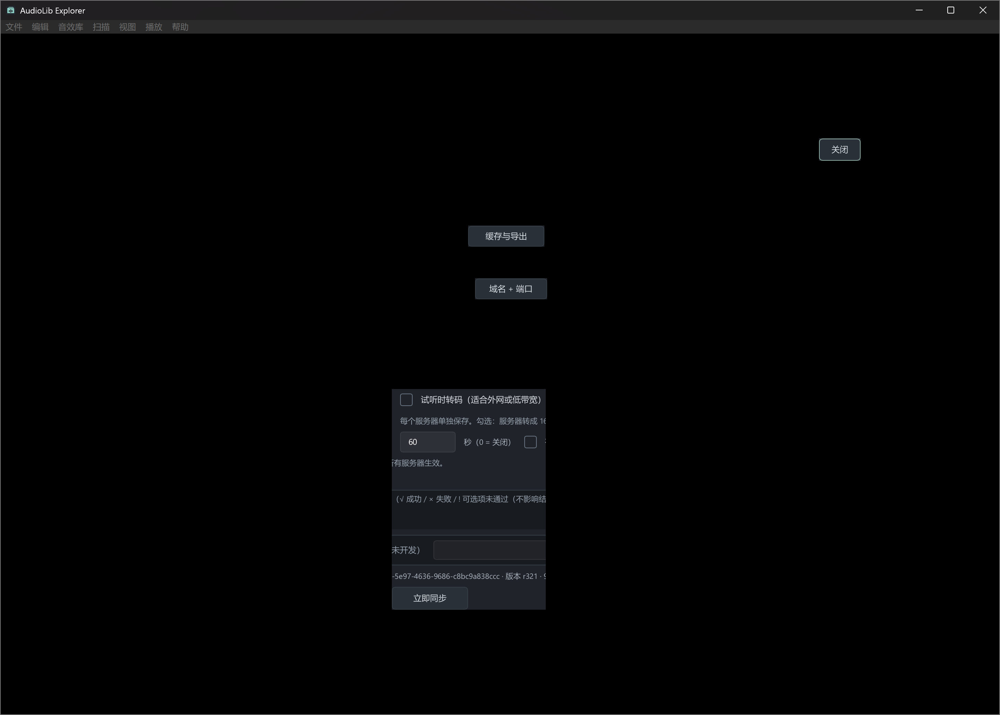

# Rust 客户端待解决问题

## UI-001：失焦后重新聚焦，界面内容丢失

- 登记日期：2026-10-12。
- 状态：待复现、待修复。用户要求先加入解决列表，后续处理；不纳入本轮缓存流程和进度条修复。
- 用户报告：软件失去焦点后，再次聚焦时 UI 大面积消失或变黑，仅部分按钮和局部控件仍然可见。报告截图处于音效库管理的服务器设置界面，原因为待查，尚不能认定数据或窗口状态丢失。
- 复现线索：打开音效库管理 → 切到其他窗口 → 返回 AudioLib Explorer。出现频率、最小化/遮挡是否必要、缩放与显示器组合尚待确认。
- 后续排查：Windows 窗口重新激活、遮挡恢复时的 Slint/winit 软件渲染重绘，以及局部脏区域与完整帧刷新。保留当前表单、选择和数据库状态进行观察。
- 验收：主窗口和音效库管理在反复失焦/聚焦、遮挡恢复、最小化/还原后都能完整显示；覆盖实际 DPI 缩放，且草稿和选择不丢失。

用户提供的现象截图：

